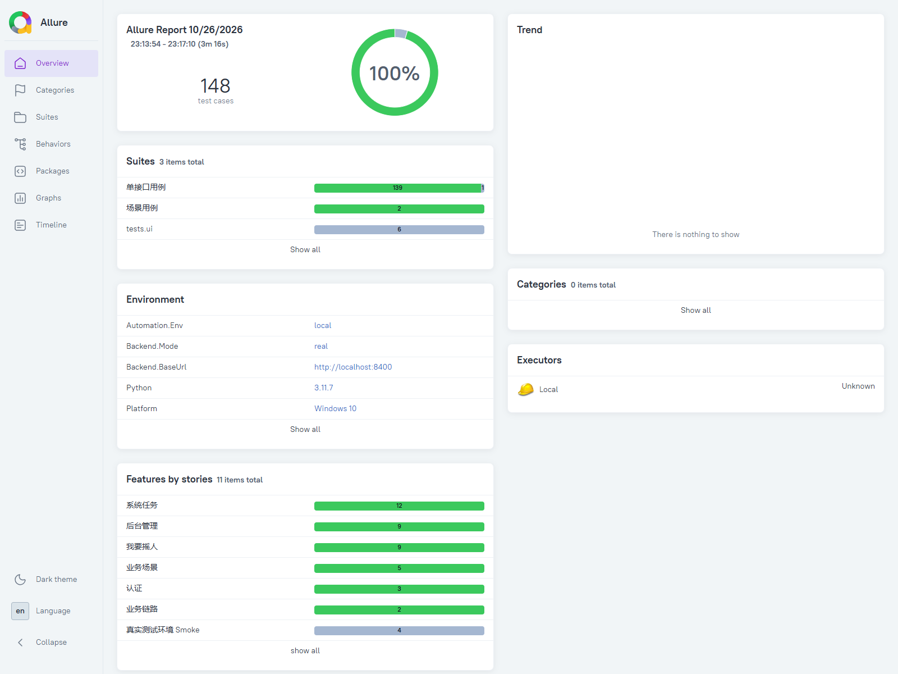
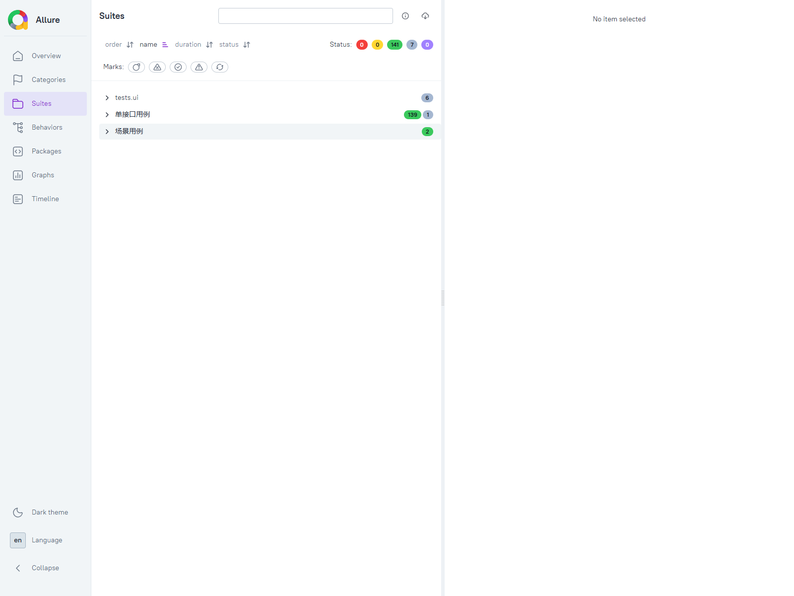

# 自动化测试工作汇报

- **汇报人**：＿＿＿＿
- **周期**：2026-10-23 ～ 10-26
- **项目**：摇人吧服务号（OpenRobotService）
- **文档日期**：2026-10-26

## 一、结论

**自动化测试框架已建成并验证通过，整体完成度约 80%。**
剩余 20% 中，一半依赖外部审批与凭据，一半需要投入时间补用例。

## 二、整体进度

| # | 模块 | 权重 | 完成度 | 加权贡献 |
|---|---|---|---|---|
| 1 | 框架与工具链（配置/夹具/断言/运行时/报告） | 25% | 100% | 25.0% |
| 2 | 接口用例（Mock 模式，131 条） | 20% | 100% | 20.0% |
| 3 | 真实环境验证（10 条，含数据库断言） | 20% | 90% ※ | 18.0% |
| 4 | 业务场景覆盖 | 20% | 40%（4/10） | 8.0% |
| 5 | CI 门禁集成 | 10% | 60% | 6.0% |
| 6 | 工单闭环（生产链路） | 5% | 50%（代码完成，未真跑） | 2.5% |
| | **合计** | **100%** | | **≈ 79.5%（约 80%）** |

※ 10 条中 9 条当前稳定通过，1 条依赖一个待合并的配置提交。

**剩余 20% 的构成：**

| 缺口 | 占比 | 卡在谁 |
|---|---|---|
| 业务场景用例未补齐（剩 6 条） | 12% | 我方投入时间 |
| 门禁首次运行验证 | 4% | PR 审批 |
| 工单闭环真跑 | 2.5% | 运维 + DBA 凭据 |
| 真实环境配置合并 | 2% | PR 审批 |

## 三、本期成果（数字均可复核）

| 指标 | 结果 |
|---|---|
| 框架库测试 | **380 项通过** |
| 接口用例（Mock 模式） | **131 项通过** |
| 真实环境用例 | **10 项通过**（含完整工单生命周期） |
| **全量回归报告** | **148 条：141 通过 / 7 跳过 / 0 失败** |
| 新增业务场景用例 | **6 条** |
| 真实执行耗时 | 0.3 秒 ～ 35 秒（真实调用后端与数据库） |
| 自动化报告 | Allure 报告，一键生成，含请求/响应/断言明细 |

> 148 条 = 131 条 Mock 接口用例 + 10 条真实环境用例 + 7 条需 UI/契约开关的跳过项。
> 说明：Mock 用例毫秒级（用于快速回归），真实用例秒级到分钟级（用于验证真实链路）。

**新增的 6 条业务场景用例**：

1. 处理人不可撤回，仅提单人可撤回
2. 处理人请求暂停 → 提单人确认 → 已暂停
3. 非处理中的工单不可请求暂停
4. 处理人请求无法解决 → 提单人确认 → 恢复处理
5. 非已解决状态不可打回，已解决可打回
6. 添加评论 → 对方可见 → 已读回执可查

## 四、证据

### 证据 1：Allure 报告总览（全量 148 条）



**148 条用例，141 通过 / 7 跳过 / 0 失败，总耗时 3 分 16 秒。**
环境信息可见：`AUTOMATION_ENV=local`、`mock=real`、`base_url=http://localhost:8400`、Python 3.11.7。

### 证据 2：用例分组明细



分为三组：

| 分组 | 条数 | 说明 |
|---|---|---|
| 单接口用例 | 139 | 接口级用例（Mock 快速回归 + 真实冒烟） |
| 场景用例 | 2 | 完整业务链路（含真实工单生命周期） |
| tests.ui | 6 | UI 用例，需 Playwright 开关，本次跳过 |

### 证据 3：测试执行输出

```text
$ pytest automation/src automation/config automation/ci_ai_gen automation/mcp_server -q
380 passed in 32.22s

$ pytest automation/tests -q
131 passed, 54 skipped in 57.91s

$ USE_MOCK=0 pytest automation/tests/real -q
..........                                                               [100%]
10 passed in 160.59s (0:02:40)
```

## 五、发现并处理的问题（本期主要价值）

| 级别 | 问题 | 业务影响 | 状态 |
|---|---|---|---|
| **P0** | 数据库迁移脚本无法从空库初始化 | **CI 门禁 100% 失败**；任何新建环境都建不了库 | 已在门禁中绕过，根因待开发修复 |
| **P1** | 删除工单接口必然返回 500 | **产品功能实际不可用**（任何工单都删不掉） | 已定位根因，待开发修复 |
| P2 | 测试用假后端与真实接口路径规则相反 | 测试全绿但真实环境必挂，**绿灯不可信** | 已修复 |
| P3 | 三个状态流转存在隐藏必填项 | 前端/测试都可能踩坑 | 已用 6 条用例锁定 |

> 说明：P0 导致门禁此前**从未真正执行过**（272 次运行全部未实际运行）。本次已修复其中的建表步骤。

## 六、需要的支持（当前阻塞）

| # | 事项 | 需要谁 | 不解决的后果 |
|---|---|---|---|
| 1 | **生产库只读接入审批**（申请单已准备） | 运维 + DBA | 工单功能用例无法真实执行，只能跑回归 |
| 2 | **2 个 PR 审批合并** | 有合并权限的同事 | 门禁无法完成首次运行验证 |
| 3 | **P0 / P1 缺陷修复排期** | 开发 | 新建环境、删除工单功能仍不可用 |

申请单：`automation/docs/ops-request-prod-readonly-access.md`

## 七、下一步计划

| 阶段 | 内容 | 前置 |
|---|---|---|
| 立即 | 合并 2 个 PR → 触发门禁首次运行 → 确认结果 | 审批 |
| 本周 | 提交生产只读凭据申请；跟进 P0/P1 修复 | 无 |
| 后续 | 补齐剩余 6 条业务场景（设计稿已完成） | 时间安排 |

## 八、风险提示

1. **门禁首次运行存在不确定性** —— 历史上从未真实执行过，首次可能暴露新问题，需预留处理时间。
2. **生产接入涉及数据外发** —— 工单标题/正文会进入 CI 环境用于生成用例，业务方已确认可接受；仍需按最小权限配置（已写入申请单）。

---

**一句话总结**：

> 框架和用例已交付并验证，能真实跑通业务链路；**当前瓶颈不在技术，在审批和凭据**。
