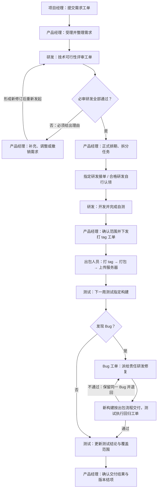

# USP 产品工作台产品设计文档

| 文档信息 | 内容 |
|---|---|
| 版本 | V1.0，待评审 |
| 日期 | 2026-11-24，Asia/Shanghai |
| 页面入口 | 后台管理 → 项目管理 → USP 产品型项目详情 |
| 适用对象 | 项目经理、产品经理、研发、测试、研发负责人、领导、出包人员、产品配置管理员 |
| 交付范围 | 产品方案与验收口径；不包含代码实现、数据库迁移或线上配置变更 |
| 示例口径 | 按用户给定的“本周 2.10.3”举例，不代表已核实的线上版本；示例姓名、模块及数量均为演示数据 |

## 一、产品目标与设计边界

### 1.1 产品定位

USP 产品工作台是产品、研发、测试共同使用的周迭代工作入口。页面按照当前用户的岗位、负责模块和实际工单，展示共同的产品状态与个性化待办。

工作台不重新建立另一套任务收件箱。所有需要人员处理、确认或接收业务通知的事项，均落到现有工单体系，并能从页面直接进入对应工单。

### 1.2 本次必须满足的目标

1. 人员、岗位名称、职责范围和页面能力可以配置，不依赖现有责任模块树已经包含完整的人员岗位信息。
2. 按“年序号.月序号.月内周版本序号”管理版本，三段均从 0 计数。
3. 技术评审先于正式排期；评审不通过必须说明原因，不能通过超时代替技术结论。
4. 产品经理安排研发任务；研发可以在授权范围内认领待认领任务。
5. 当周研发并自测，产品经理发起打 tag 任务，随后打包、上传，下周测试并派发 Bug 修复任务。
6. 同一页面同时显示“本周研发”和“上周版本测试”，避免把两个版本的进度混为一谈。
7. 产品状态、开发内容、Bug、历史版本共用业务数据；不同岗位按权限看到不同模块、范围和操作。

### 1.3 本次不默认包含的内容

- 不整体迁移原功能拓扑的内容编写与保存服务。
- 不默认实现禅道双向写回，也不假设当前已支持自动创建禅道需求、任务或 Bug。
- 不将上传服务器等同于正式生产发布，不自动触发生产部署。
- 不要求领导审批每个需求、任务或版本；只有明确配置的决策事项才进入领导待办。
- 不修改普通客户项目、非 USP 工单的既有流转规则。

## 二、对象与职责划分

### 2.1 业务对象

| 对象 | 定义 | 关键关联 |
|---|---|---|
| 产品 | 一个明确的 USP 产品型项目，不是所有客户现场项目的集合 | 成员、岗位、模块、版本 |
| 功能模块 | 产品的功能划分，以稳定 ID 关联，不依赖名称匹配 | 责任模块树节点、拓扑节点、责任人 |
| 需求 | 项目经理提出、产品经理整理、研发评审的交付诉求 | 来源工单、评审轮次、开发任务、目标版本 |
| 研发任务 | 一项有唯一当前处理人的开发工作 | 需求、模块、研发日期、版本、工单 |
| 周迭代 | 一个周一至周日的工作窗口 | 当周开发版本、当周测试目标、工单与活动 |
| 产品版本 | 一组计划在同一出包窗口交付的内容 | 版本号、需求清单、开发任务、构建、测试 |
| 构建 | 某版本的一次不可覆盖的打 tag、打包、上传结果 | tag、提交记录、包信息、测试结果 |
| Bug | 测试或现场发现的可追踪缺陷 | 发现版本与构建、模块、责任研发、修复构建、回归记录 |
| 工单 | 向具体人员交付任务、收集结果和发送业务通知的统一载体 | 上述对象、流程阶段、处理人、截止时间 |

同一个需求可以拆为多项研发任务，并分批进入不同版本。版本展示实际纳入的任务与验收范围，不因关联了一个需求就宣称该需求全部交付。

### 2.2 四种信息必须分开

| 信息 | 示例 | 设计要求 |
|---|---|---|
| 姓名与账号 | 张三、系统用户 ID | 从现有人员账号选择，不手工输入一个无法接单的姓名 |
| 岗位名称 | USP 产品经理、调度研发工程师 | 可配置展示名称，支持一人多岗 |
| 职责范围 | 负责 USP 的任务调度模块 | 可配置全产品或指定模块范围 |
| 操作权限 | 发起评审、安排版本、认领任务、提交测试结论 | 单独授权，不能仅凭岗位名称或职级推断 |

现有责任模块树继续负责功能划分与工程师关联。工作台新增“岗位与人员职责配置”，补齐岗位、产品角色和流程责任人，不强行把完整组织模型写进树节点。

## 三、人员、岗位与职责的可配置设计

### 3.1 配置入口

主入口：USP 工作台 → 产品设置 → 岗位与人员职责。

辅助入口：后台管理 → 其他 → 工单与派单 → 责任模块树，在 USP 产品下提供“关联岗位与人员职责”入口，跳转到同一份配置，不保存两套人员名单。

配置分为五个页签：岗位字典、产品成员、模块职责、流程责任人、页面与通知规则。

### 3.2 岗位字典

| 字段 | 规则 |
|---|---|
| 岗位编码 | 系统稳定标识；岗位更名不改变既有绑定 |
| 岗位名称 | 可配置，例如“USP 产品经理”“算法研发”“测试工程师” |
| 职责说明 | 说明该岗位在产品流程中负责什么 |
| 能力模板 | 可参考产品、研发、测试、领导等模板；实际权限逐项确认 |
| 默认工作视图 | 决定进入页面后的模块排序，不额外授予权限 |
| 状态 | 启用、停用；停用前提示当前成员与未完成工单影响 |

预置项目经理、产品经理、研发工程师、研发负责人、测试工程师、测试负责人、领导、出包执行人、产品配置管理员。预置名称可以修改，也允许新增岗位。

自定义名称只改变展示。系统按岗位编码与能力配置判断行为，不通过名称中是否包含“领导”“产品”“研发”等文字判断权限。

### 3.3 产品成员配置

| 字段 | 规则 |
|---|---|
| 人员 | 从有效系统账号选择，展示姓名、账号、所属部门 |
| 所属产品 | 指定当前 USP 产品 ID，防止跨产品误授权 |
| 岗位 | 可多选，至少一个有效岗位 |
| 默认身份 | 一人多岗时的默认工作视图 |
| 职责范围 | 全产品或指定模块；上级模块是否包含后代需明确配置 |
| 有效期 | 可设置开始与结束时间，支持临时岗位与代理 |
| 代理人 | 必须是有效账号并具有所需范围与权限，不通过“代理”自动扩权 |
| 状态 | 待确认、生效、停用 |

示例配置：

| 人员 | 岗位 | 职责范围 | 默认视图 |
|---|---|---|---|
| 张三 | USP 产品经理 | USP 全产品 | 产品视图 |
| 李四 | 研发工程师 | 任务调度模块 | 研发视图 |
| 王五 | 研发工程师、出包执行人 | 交通管理模块；另具指定版本出包权限 | 研发视图 |
| 赵六 | 测试工程师 | 指定模块或指定测试版本范围 | 测试视图 |
| 陈七 | 领导 | 被授权的 USP 产品范围 | 管理视图 |

### 3.4 模块职责配置

每个模块可以配置产品负责人、研发负责人、参与研发、测试负责人、参与测试及兜底处理人。支持多人协作，但每张执行工单只保留一个当前处理人。

责任模块树中已有的工程师关联，可以导入为候选草稿。管理员确认岗位、范围与能力后才生效，不能仅因某人出现在 engineers 列表就自动授予产品排期或审批权限。

功能拓扑节点、责任模块树节点和工作台模块使用显式映射。允许一个责任模块对应多个拓扑节点；节点改名不会改变人员绑定，节点删除或映射失效时给出治理提示。

### 3.5 流程责任人与默认规则

| 配置项 | 内容 |
|---|---|
| 产品经理 | 需求接收、评审发起、正式排期、出包任务发起、版本结项 |
| 技术评审人 | 按模块配置必审人；可设置咨询人，咨询意见不冒充必审结论 |
| 研发负责人 | 任务分配兜底、无人认领处理、技术争议升级 |
| 出包执行人 | 默认 tag、打包、上传人员，允许三项分别指定 |
| 测试负责人 | 接收测试计划并分配测试与回归任务 |
| 升级接收人 | 接收超时、无人承接、风险决策工单 |
| 节奏设置 | 开发周、计划出包日、次周测试开始日、时区、各阶段时限 |
| 待认领范围 | 哪些研发可见、可认领哪些模块的任务 |

单次明确指定且有效的处理人优先于模块默认配置，模块配置优先于产品默认配置。必审人不能通过临时改派被直接绕过；替换必审人需要有权限者确认并留痕。

缺少有效处理人时，流程显示“配置阻塞”，为已配置的治理责任人生成工单。产品管理员和兜底处理人在启用流程前必须配置；配置不完整时不得假装派单成功。

### 3.6 配置权限与变更

- 人员与岗位分配、权限授予由现有权限体系中的授权管理员执行。产品经理可以维护日常流程默认人，但不能凭此给自己或他人扩大权限。
- 领导岗位不自动获得人员管理、代码操作、评审代签或所有产品访问权。
- 调整职责后，新任务使用新配置；已有工单不静默改派，需要显式确认交接。
- 人员停用、职责撤销或岗位到期时，撤销后续访问并列出待交接工单，交由授权负责人处理。
- 历史记录保留操作发生时的姓名与岗位快照，并关联稳定用户 ID；当前页面展示当前有效岗位。
- 每次变更记录操作者、时间、前后差异、影响范围与生效时间。

## 四、进入页面时的身份判定

### 4.1 判定顺序

1. 识别登录用户的稳定账号 ID，从现有账号资料读取姓名。
2. 读取当前 USP 产品内有效的成员、岗位、职责范围和权限配置。
3. 叠加经授权的项目角色与任务参与关系，不使用姓名、部门名称或职级猜测岗位。
4. 生成可见模块、可读数据范围、可执行操作以及默认模块顺序。
5. 加载当前用户的实际待办工单；岗位模板决定推荐内容，不能替代工单实际处理人判断。

授权采用“岗位能力与该岗位职责范围成对计算，再合并”的方式。不能把 A 岗位的全产品阅读范围，与 B 岗位的局部修改权限交叉组合成全产品修改权。

页面隐藏按钮不是最终授权。模块列表、统计、工单详情与执行接口必须采用同一产品、模块和对象权限校验，不能通过汇总数字泄露无权阅读的其他模块内容。

### 4.2 身份条

示例：姓名：李四｜岗位：USP 研发工程师｜职责：任务调度｜当前视图：研发。

一人多岗时展示全部有效岗位，并提供“产品 / 研发 / 测试”等已授权视图切换。切换只改变排序与筛选，不改变已有权限，也不允许切到未获得的领导视图。

未配置岗位但具有产品阅读权时，展示“姓名｜岗位待配置”，仅开放被授权的公共阅读和本人原有工单入口，不开放认领、评审、排期等额外操作。无产品访问权时显示无权限说明与申请配置入口，不暴露产品数据。

申请配置会生成治理工单给有权限的配置管理员，不仅提示“请联系管理员”。

### 4.3 不同岗位的默认待办

| 岗位 | 优先展示的待办 | 不默认授予的能力 |
|---|---|---|
| 项目经理 | 本人需求受理进度、待补充信息、交付结果确认 | 全产品研发排期、其他客户项目数据 |
| 产品经理 | 待受理、待发起评审、评审退回、待排期、待发起出包、待结项 | 代替研发给出技术可行结论 |
| 研发工程师 | 待技术评审、可认领、本人开发、自测、Bug 修复 | 修改他人排期、测试代签、默认全产品编辑 |
| 研发负责人 | 必审需求、无人认领、开发阻塞、模块责任不明与改派 | 自动获得产品排期权限 |
| 测试工程师 | 待开始测试、本周测试、待回归、复测失败项 | 排期、修改 tag、代研发自测 |
| 测试负责人 | 测试分配、测试阻塞、回归覆盖、版本质量确认 | 默认执行生产发布 |
| 领导 | 明确指派的风险决策、超时升级、跨团队协调 | 所有日常事项都成为本人待办 |
| 出包执行人 | 待打 tag、待打包、待上传、失败重试 | 擅自修改版本范围或测试结论 |

“我的待办”按处理人和有效任务状态去重，不按岗位重复统计。一人同时是研发和出包人时，同一张工单只出现一次。

## 五、版本编号规则

### 5.1 用户已确定的规则

主版本号为三段：年序号.月序号.月内周版本序号。

| 段位 | 规则 | 示例 |
|---|---|---|
| 第一段 | 从基准年开始按年递增，基准年为 0 | 若基准年为 2024，则 2026 为 2，2027 为 3 |
| 第二段 | 自然月从 0 开始，1 月为 0，12 月为 11 | 2026 年 11 月为 2.10；12 月为 2.11 |
| 第三段 | 月内首个周出包槽为 0，后续每周递增 | 当月第 4 个周出包槽为 3 |

跨年时第一段加 1，第二段和第三段按新年首月重新从 0 计数。该编号是本产品的日历周版本规则，不按语义化版本号的重大、次要、修订变更解释。

### 5.2 跨月归属的建议口径

用户尚未明确跨月的一周归哪个月。本稿建议以“计划出包日”确定版本年月，默认每周五出包；该默认日期可配置，启用前需确认。

选择这一口径，是因为本周开发的包可能在下个月测试；不能按测试日期重新计算它的版本号，也不能让一周内的版本随日历翻月而变更。

以基准年 2024、每周五计划出包为例：

| 开发周 | 计划出包日 | 主版本号 | 说明 |
|---|---|---|---|
| 2026-11-02～2026-11-08 | 2026-11-06 | 2.10.0 | 11 月首个周出包槽 |
| 2026-11-09～2026-11-15 | 2026-11-13 | 2.10.1 | 11 月第 2 个槽 |
| 2026-11-16～2026-11-22 | 2026-11-20 | 2.10.2 | 11 月第 3 个槽 |
| 2026-11-23～2026-11-29 | 2026-11-27 | 2.10.3 | 与用户给定的“本周 2.10.3”一致；此日期为计划，不表示已经出包 |
| 2026-11-30～2026-12-06 | 2026-12-04 | 2.11.0 | 跨月周按计划出包日归入 12 月 |
| 2026-12-28～2027-01-03 | 2027-01-01 | 3.0.0 | 跨年示例；遇节假日可调整执行日，但已冻结编号不改 |

基准年 2024 是根据当前日期与示例 2.10.3 推导的建议值，不是已确认的历史事实。产品设置应提供基准年和初始化编号映射；导入既有版本时保留原编号。

### 5.3 编号、取消与延期

- 按月计划出包槽生成序号，不使用简单的“日号除以 7”，也不采用 ISO 全年周数作为第三段。
- 版本正式建立并下发任务后，编号、原始计划归属月和计划槽锁定。延期只修改预计与实际日期，不因跨月而重命名。
- 已取消版本保留记录，编号不复用；取消后同月后续槽不重新编号，避免外部工单与包引用失效。
- 每月首个计划槽为 0，不保证首个实际成功上传的包一定为 0；若 0 槽取消，页面明确显示取消记录。
- 同一周版本内重做包，不递增第三段；使用独立构建号区分。紧急修复也不得覆盖已上传的包或已存在的 tag。
- 产品范围内主版本号唯一，构建标识唯一；并发创建不能产生相同编号。

### 5.4 构建与 tag

建议将主版本号与构建标识分开。例如主版本 2.10.3 下有构建 001、002，展示为“2.10.3 / 构建 002”。建议 tag 采用 usp/2.10.3/build.002，实际命名需与现有仓库约定确认。

每次代码变化后重新交付，必须关联新的不可变 tag、提交标识与包校验值。测试结论绑定具体构建，不把构建 001 的通过结论直接套用到构建 002。

## 六、按周展示：研发与测试两条并行工作线

### 6.1 默认周视图

页面默认选择当前北京时间所在周，周一至周日。例如 2026-11-24 进入页面，默认周为 2026-11-23～2026-11-29。

这一周同时展示：

- 本周研发：2.10.3 的需求、开发、自测、出包任务。
- 本周测试：上周交付的 2.10.2，以及明确延期到本周的其他测试任务。
- 本周修复：本周接到的 Bug，不论它发现于哪个历史版本。
- 历史追踪：未闭环的评审、开发、测试与缺陷，不因进入新一周而消失。

### 6.2 节奏示例

| 时间 | 研发工作线 | 测试工作线 | 产品经理关注 |
|---|---|---|---|
| 2026-11-23～2026-11-29 | 开发并自测 2.10.3，完成 tag、打包、上传 | 测试 2.10.2，提 Bug 并回归修复 | 跟踪研发与质量风险，确认 2.10.3 出包范围 |
| 2026-11-30～2026-12-06 | 开发并自测 2.11.0，同时处理获准插入的缺陷修复 | 测试 2.10.3 具体构建 | 排期新需求，处理上一版本测试结论 |

常规顺序是 W 周开发与出包、W+1 周测试。跨周延期时保留原归属和实际执行周；不自动关闭未完成任务，不自动生成一份重复任务。

### 6.3 筛选与统计口径

| 筛选项 | 规则 |
|---|---|
| 工作周 | 控制当周开发计划、当周测试计划与当周活动，不等于发现周或创建周 |
| 版本 | 可分别筛选开发目标版本和测试目标版本，明确显示用途 |
| 功能模块 | 只能在用户授权范围内选择 |
| 人员 | 个人默认本人；具团队权限者可查看授权团队 |
| 状态 | 支持未开始、进行中、阻塞、已完成等业务状态 |

“我的待办”默认跨周汇总所有未完成的本人行动项，并显示归属周，不能被顶部周筛选静默隐藏。可主动切换“仅本周”，但必须保留“跨周未完成”提醒入口。

本周开发任务数以计划进入本周的开发任务为分母；自测完成率以本周已纳入范围的开发任务为分母。正式版本进入出包时生成范围快照，后来顺延的任务保留顺延记录，不通过删除任务美化完成率。

本周新发现 Bug、当前未关闭 Bug、本周已回归 Bug 是三个不同指标。所有统计按 Bug ID 去重，并可下钻到同口径列表。

页面分别标识“本周开发版本”“最新已上传构建”“当前在测版本”“最新测试通过构建”。只有登记了正式上线记录，才显示“线上稳定版”，上传或测试通过不能代替上线状态。

## 七、完整业务流程

### 7.1 主流程



### 7.2 项目经理提交，产品经理受理

项目经理从工作台或原工单入口提出需求，填写所属客户项目、问题背景、业务目标、期望日期及附件。系统给 USP 对应产品经理生成需求受理工单。

产品经理补齐验收标准、影响模块和优先级，可合并多个来源相同的诉求，也可退回补充信息。来源工单保留客户项目归属，产品需求只建立关联，不把原客户工单搬到 USP 产品项目。

### 7.3 研发技术评审

- 产品经理提交已整理的需求给必审研发，每位必审人一张评审工单。
- 研发填写技术可行结论、影响范围、实现限制、建议工作量与风险；“不通过”和“需补充”必须填写原因。
- 全部必审人明确通过，需求才进入待排期。咨询人的意见单独展示，不冒充必审通过。
- 任一必审人不通过，当前轮次结束，未完成评审单标记本轮失效并保留记录；产品经理收到需求处理工单。
- 产品经理调整后形成新修订、新轮次，不复用旧评审结论。已拆任务后发生实质范围变化，也需评估是否重新评审。
- 评审超时只催办或升级，不能自动通过，产品经理不能因超时代替研发签署技术可行结论。

评审前允许填写业务期望日期，但它不是正式研发排期。只有技术评审通过后，产品经理才确认版本、研发人员与研发起止日期。

### 7.4 正式排期、任务下发与认领

产品经理选择目标版本，按模块拆分研发任务，填写任务内容、验收标准、计划开始日、计划结束日、自测截止日、预估工作量和依赖项。

任务有两种承接方式：指定研发处理，或进入有明确模块与资格范围的待认领池。池内任务仍是工单，不另做一套可与工单脱离的任务卡。

认领时校验账号状态、研发能力、模块范围和任务未被占用。两人同时认领只能一人成功；成功后工单记录处理人，其他人看到“已由某人认领”。研发不能通过认领修改目标版本和原计划日期。

超过认领时限，向研发负责人生成督办工单。改派由有权限者完成并通知原、新处理人；已开始任务不因配置变化自动改派。

### 7.5 研发开发与自测

开发和自测作为同一研发工单的两个业务阶段，避免同一个人重复收到内容相同的任务。开发阶段完成不等于研发工单已经满足交付条件。

研发需要填写代码分支、提交标识、完成说明、自测环境、验证项、执行结果与证据。自测不通过时仍由研发处理，不能进入本次出包就绪范围。

所有纳入本次范围的研发任务自测通过，或未完成任务已由产品经理明确顺延并留痕后，系统生成一次“出包准备确认”工单给产品经理。

### 7.6 产品经理发起 tag、打包与上传

产品经理在出包准备工单中确认版本范围、未完成任务去向、代码基线和已知风险，再明确点击“发起打 tag 任务”。自测完成不能直接绕过产品经理生成 tag 执行任务。

| 阶段 | 处理人 | 必填输出 | 进入下一步的条件 |
|---|---|---|---|
| 打 tag | 指定研发或出包人员 | 主版本、构建号、仓库、分支、准确提交标识、tag | tag 结果已记录且与确认范围一致 |
| 打包 | 指定打包人员 | tag、构建结果、包名、平台或架构、校验值、生成时间 | 构建成功且包信息完整 |
| 上传 | 指定上传人员 | 目标环境、服务器文件位置、包大小、校验结果、上传时间 | 上传成功，目标文件与记录的包一致 |

三个阶段分别是关联工单；即使处理人相同也保留执行顺序与结果。创建下一张工单时自动带入上一步数据，不要求重复填写。

失败时停留在失败阶段，不能继续把版本标记为“已交付测试”。重试保留尝试记录；只重复传输同一文件可以重试原上传任务，代码或包内容变化则产生新构建并重新确认。

服务器凭据不放入工单正文、通知或产品资料。页面仅记录目标配置标识和有权限访问的制品位置。

### 7.7 下一周测试

上传校验通过后，系统创建绑定准确版本与构建的测试计划工单，计划开始时间默认下一周首个工作日。提前创建的任务显示“待开始”，不能显示为已经测试。

测试负责人可将计划拆给不同测试人员。测试人员查看本次开发清单、验收标准、变更影响、已知问题和包位置，记录环境、实际构建、测试项与结果。

测试计划可以跨周继续执行，也可以同时覆盖多个历史版本，但每项结果必须绑定具体版本和构建。不能因周切换而重置测试进度或自动认定通过。

### 7.8 Bug 修复与回归

测试发现问题时直接生成 Bug 工单，携带发现版本与构建、复现步骤、预期与实际结果、严重程度、证据和功能模块。

默认责任研发按“可确认的相关研发任务处理人 → 模块研发负责人 → 产品研发兜底人”选择，测试或负责人可在授权范围内调整。没有明确归属时先进入责任确认，不随机分配，也不丢失测试发现。

研发提交修复与自测结果后，Bug 进入待回归，不直接关闭。若需新包，由产品经理确认修复出包范围，沿用 tag、打包、上传流程，再生成绑定修复构建的回归工单。

测试回归通过后关闭该 Bug；不通过则保留同一 Bug ID、增加回归轮次并退回原修复链路，不重复创建一个相同 Bug。

修复需要进入新开发版本、原测试版本补丁构建，或两边都要合并时，必须明确目标分支、目标版本与构建，不能假设“新版本已修复”等于原测试版本已修复。

### 7.9 版本结项

测试负责人提交测试总结，产品经理收到版本结果确认工单。版本结项需满足：纳入范围明确、测试项有结论、阻塞缺陷清零、未完成事项有明确去向、发布说明或交付说明完整。

默认所有未关闭 Bug 都阻止“完整闭环”。若产品允许低风险遗留，需由明确配置的质量确认人和产品负责人在风险处置工单中共同确认，并指定修复版本与责任人；状态显示“带遗留交付”，不能伪装成“无缺陷通过”。阻塞缺陷不能通过一般风险接受绕过。

版本测试通过、带遗留交付与正式生产发布是不同结果。历史版本之后新发现的 Bug 继续挂载该版本，不篡改当时的结项快照，也不直接将历史版本改回研发中；当前质量提示随新增缺陷更新。

## 八、工单与业务通知矩阵

### 8.1 每一步都能定位到工单

| 触发事件 | 工单或工单阶段 | 当前处理人 | 完成后结果 |
|---|---|---|---|
| 项目经理提交需求 | 需求受理单 | 产品经理 | 受理、退回补充或拒绝并说明原因 |
| 产品经理发起技术评审 | 技术评审单，每位必审人一张 | 对应必审研发 | 通过、不通过、需补充 |
| 技术评审未通过 | 需求修改单 | 产品经理 | 补充、调整后重提或撤销 |
| 全部技术评审通过 | 排期与任务下发单 | 产品经理 | 明确版本、日期、任务与承接方式 |
| 指定开发或进入待认领池 | 开发单，含自测阶段 | 指定研发或认领成功的研发 | 开发结果、自测结果与提交标识 |
| 待认领超时、开发阻塞 | 督办或协调单 | 研发负责人或配置的升级人 | 分配、协调、调整建议 |
| 本次范围满足出包条件 | 出包准备确认单 | 产品经理 | 确认范围并明确发起 tag 任务 |
| 产品经理确认出包 | 打 tag 单 | 指定研发或出包人员 | 唯一 tag 与准确提交标识 |
| tag 完成 | 打包单 | 指定打包人员 | 构建与制品记录 |
| 打包成功 | 上传单 | 指定上传人员 | 服务器制品与校验结果 |
| 上传成功 | 次周测试计划单及测试执行单 | 测试负责人、具体测试人员 | 测试结果与缺陷清单 |
| 测试发现 Bug | Bug 修复单，即 Bug 的执行工单 | 责任研发 | 修复与自测结果，不直接关闭 Bug |
| 修复构建就绪 | Bug 回归单 | 对应测试人员 | 通过关闭，或退回同一 Bug |
| 测试结果满足结项条件 | 版本结果确认单 | 产品经理 | 结项、退回补充或风险处置 |
| 结果确认需回复来源项目 | 来源工单结果更新；需确认时发结果确认单 | 原项目经理 | 原需求交付结果可追踪 |
| 需要风险接受或跨团队决策 | 风险处置或决策单 | 明确配置的决策人 | 决策、理由、责任人与期限 |
| 无岗位、失效人员或缺配置 | 配置治理单 | 授权配置管理员或兜底人 | 补齐配置、完成交接 |

### 8.2 通知规则

- 新任务通知、处理结果、退回、改派、催办、升级都必须绑定具体工单 ID 和业务事件，点击后进入原工单，不发送无法追溯的独立业务消息。
- 仅告知结果时，在来源工单更新动态并通知有权参与者；需要对方处理或确认时才生成新的行动工单，避免为每条消息制造重复任务。
- 待认领阶段只向合格候选人展示同一张工单，认领成功后按实际处理人发送任务通知，不给每个候选人复制一张开发单。
- 重复催办记录在原工单；配置的升级需要决策时另建协调工单，并关联原事项。
- 工单创建成功、通知发送失败时，保留工单并重试通知；不能因消息失败重复创建任务。
- 通知遵循工单和产品权限。接收范围不因为“抄送领导”而自动扩大，消息不携带无权查看的客户正文或服务器秘密。

### 8.3 防重复与异常处理

同一“产品＋业务对象＋流程阶段＋轮次或构建＋接收人”只生成一次有效行动工单。重复点击、消息重放或后台重试必须返回同一结果。

多人评审按必审人分别去重；Bug 复测按回归轮次区分；新构建按构建号区分。任务认领和流程推进需要并发保护，不允许同一任务出现两个当前处理人。

业务结果与后续任务的生成必须具备可恢复的一致性。若后续派单失败，页面显示“待流转”并允许受控重试，不宣称下一阶段已有人处理。

工单通用状态与业务结论分开保存。“工单已关闭”不能自动解释为技术评审通过、自测通过或测试通过；只有授权人员提交有效业务结果后，才满足下一阶段条件。

## 九、页面模块拆分

### 9.1 模块目录

每个模块独立配置可见能力、数据范围和操作能力。模块内可出现相同的需求或工单摘要，但始终引用同一业务对象，不能形成不同岗位各自维护的副本。

| 编号 | 模块 | 主要内容 | 主要操作与去向 |
|---|---|---|---|
| M01 | 身份与职责条 | 姓名、岗位、职责模块、当前视图、配置异常 | 切换已授权视图、查看职责、申请配置 |
| M02 | 工作周与范围选择 | 当前周、开发版本、测试版本、模块、人员 | 上一周、下一周、回到本周；保存个人筛选 |
| M03 | 我的待办 | 本人跨周未完成工单、截止时间、阶段、阻塞原因 | 处理工单、认领、催办；按工单 ID 去重 |
| M04 | 共同产品状态 | 本周开发、自测、出包；当前测试、Bug 与风险 | 下钻到同口径列表和版本详情 |
| M05 | 需求与技术评审 | 来源、修订、验收标准、评审人、结论与理由 | 提需求、整理、发起评审、提交结论、查看轮次 |
| M06 | 研发排期与认领 | 目标版本、模块、日期、人员、工作量、依赖 | 产品排期与下发；研发在授权范围内认领 |
| M07 | 开发与自测 | 研发任务、代码提交、自测清单、证据、延期 | 处理本人开发工单、提交自测、报告阻塞 |
| M08 | 版本与出包 | 范围清单、准备确认、tag、打包、上传、构建 | 产品发起出包；执行人处理各阶段工单 |
| M09 | 测试计划与执行 | 本周及延期测试、构建、环境、测试项、覆盖 | 分配测试、记录结果、创建 Bug、提交总结 |
| M10 | Bug 与回归 | 发现版本、修复版本、严重程度、责任研发、回归轮次 | 修复、安排构建、回归通过或退回 |
| M11 | 功能拓扑与职责 | 原 USP 拓扑、节点正文、负责人、相关需求与任务 | 搜索、缩放、查看节点；按原站权限编辑原文 |
| M12 | 历史版本与交付说明 | 历史范围快照、包记录、测试结论、遗留项、变更 | 按周、月、版本检索；查看历史工单链 |
| M13 | 管理风险与团队负载 | 延期、阻塞、认领空缺、跨周欠项、授权团队负载 | 下钻、催办、发起协调与决策工单 |
| M14 | 产品设置 | 岗位、人员、模块职责、流程默认人、编号与节奏 | 授权配置管理、影响预览、生效与审计 |

### 9.2 默认岗位模块矩阵

“全”表示在岗位已授权的产品范围内查看；“相关”表示本人、所负责模块或参与任务；“来源”仅表示本人有权查看的来源需求。表格是默认模板，不代表名称相同就自动获得权限。

| 模块 | 产品经理 | 研发 | 测试 | 领导 | 项目经理 | 出包人员 |
|---|---|---|---|---|---|---|
| M01 身份职责 | 本人 | 本人 | 本人 | 本人 | 本人 | 本人 |
| M02 工作周范围 | 全 | 相关 | 相关 | 授权范围 | 来源 | 指派版本 |
| M03 我的待办 | 本人 | 本人 | 本人 | 本人决策单 | 本人 | 本人 |
| M04 产品状态 | 全 | 相关范围共用事实 | 相关范围共用事实 | 授权汇总 | 来源交付状态 | 出包状态 |
| M05 需求评审 | 整理、发起、跟踪 | 指定评审、查看相关 | 查看验收标准、咨询 | 授权查看、风险决策 | 提出及补充本人需求 | 查看本次范围摘要 |
| M06 排期认领 | 正式排期、下发 | 查看本人、合格认领 | 查看相关日期 | 授权查看 | 来源交付计划 | 出包计划 |
| M07 开发自测 | 跟踪全范围 | 本人执行、模块相关阅读 | 查看相关自测结果 | 授权汇总 | 来源进度摘要 | 查看本次基线就绪情况 |
| M08 版本出包 | 确认范围、发起 | 查看相关、被指派时执行 | 查看制品与变更 | 授权查看 | 已确认交付摘要 | 执行被指派阶段 |
| M09 测试 | 查看范围与结果 | 查看相关结果 | 被指派范围执行 | 授权质量汇总 | 来源验收结果摘要 | 查看与制品相关的问题 |
| M10 Bug 回归 | 跟踪、协调 | 相关阅读、本人修复 | 相关阅读、提 Bug、回归 | 授权质量汇总 | 来源相关可公开内容 | 与出包相关的问题 |
| M11 功能拓扑 | 授权范围 | 授权范围 | 授权范围 | 授权范围 | 授权的功能资料 | 授权范围 |
| M12 历史 | 全 | 相关 | 相关 | 授权范围 | 来源交付历史 | 指派版本历史 |
| M13 管理风险 | 产品风险、排期风险 | 研发负责人另行授权 | 测试负责人另行授权 | 授权团队管理 | 本人来源风险 | 本人出包阻塞 |
| M14 设置 | 仅获授权的流程设置 | 默认不开放 | 默认不开放 | 默认不开放 | 默认不开放 | 默认不开放 |

产品配置管理员在已有管理权限允许的范围内维护 M14。配置管理权限不自动授予所有业务工单的查看或代办权；现有系统级管理员权限仍按原体系执行。

### 9.3 核心列表字段

| 列表 | 必须展示的字段 |
|---|---|
| 我的待办 | 工单标题、任务阶段、关联需求或 Bug、版本、归属周、截止时间、当前阻塞、操作入口 |
| 需求评审 | 标题、来源项目、产品经理、模块、修订、必审进度、评审结论、理由、期望日期 |
| 研发排期 | 需求、任务、模块、处理人或待认领、计划起止、自测截止、目标版本、实际完成、顺延去向 |
| 出包 | 主版本、构建、范围快照、产品确认人、tag、提交标识、包状态、上传状态、下一处理人 |
| 测试 | 测试目标版本和构建、测试周、处理人、环境、测试项进度、阻塞 Bug、结论 |
| Bug | 标题、严重程度、发现版本和构建、模块、发现人、责任研发、计划修复版本、实际修复构建、回归状态 |

字段或正文无权限时不返回其真实值。来源项目摘要需要遵守客户数据权限，不因为同属一个 USP 功能模块就开放其他客户的附件与原话。

## 十、页面布局与交互

### 10.1 电脑端总览

```text
后台管理 / 项目管理 / USP 产品工作台

USP 产品工作台                               [需求入口] [产品设置]
张三｜岗位：USP 产品经理｜职责：全产品｜视图：产品

工作周：2026-11-23～11-29  [上一周] [本周] [下一周]
开发版本：2.10.3    测试目标：2.10.2    范围：已授权模块

[总览] [需求评审] [研发任务] [版本出包] [测试与Bug] [功能资料]

┌─────────────────────────────────────────────────────┐
│ 我的待办（跨周未完成）                                │
│ 待受理 / 待评审处理 / 待排期 / 待发起出包 / 待结项     │
│ 点击直接处理原工单；超过本周的欠项仍保留                │
├──────────────────────────┬──────────────────────────┤
│ 本周研发：2.10.3          │ 本周测试：2.10.2          │
│ 需求及研发任务进度        │ 目标构建与测试进度        │
│ 自测通过 / 未通过         │ 新发现 / 待修复 / 待回归  │
│ tag → 打包 → 上传        │ 当前阻塞与测试结论        │
├──────────────────────────┴──────────────────────────┤
│ 依据岗位加载：需求评审 / 任务认领 / 自测 / 测试执行等   │
├──────────────────────────┬──────────────────────────┤
│ 功能拓扑与模块职责        │ 风险、跨周欠项、最近动态   │
├──────────────────────────┴──────────────────────────┤
│ 历史版本：按周/月查看范围、构建、测试与工单链            │
└─────────────────────────────────────────────────────┘
```

导航只展示有访问能力的模块。总览中的产品状态使用同一数据源，但按当前用户权限裁剪；不能仅在详细页做权限控制。

### 10.2 不同岗位进入后的排序

| 视图 | 推荐顺序 |
|---|---|
| 产品经理 | 我的待办 → 双工作线状态 → 需求评审与排期 → 出包确认 → Bug 风险 → 历史 |
| 研发 | 我的待办 → 本人开发与自测 → 可认领任务 → 本人 Bug → 相关评审 → 双工作线状态 |
| 测试 | 我的待办 → 当前测试构建 → 测试项 → 待回归 Bug → 本版开发说明与自测结果 |
| 领导 | 双工作线状态 → 阻塞与延期 → 缺陷质量 → 团队负载 → 本人决策工单 |
| 出包人员 | 我的出包工单 → 已确认范围与基线 → tag、包、上传记录 → 失败与重试 |
| 项目经理 | 本人来源需求 → 待补充工单 → 研发交付计划摘要 → 测试与交付结果 |

### 10.3 详情交互

需求、版本、Bug、任务均提供详情抽屉与可直接访问的详情地址。详情中固定展示“当前阶段、当前处理人、下一步条件、关联工单”，避免只展示一条不知由谁推进的进度条。

业务按钮如“发起评审”“确认排期”“发起 tag”“提交回归”直接操作关联工单或生成下一阶段工单，并展示结果；不要求用户先在页面提交一次，再去系统任务重复提交。

不可执行的按钮明确显示缺少的条件，例如“还有 1 个必审人未通过”“2 项自测未通过”“上传校验未完成”，而不是只有置灰状态。

### 10.4 手机端

- 保留身份条、工作周、我的待办和研发/测试两个状态卡，列表改单列卡片。
- 任务关键操作不依赖鼠标悬停，详情提供清晰的工单处理按钮。
- 功能拓扑支持进入全屏后双指缩放、拖动、点击节点阅读，提供搜索、复位和树形列表模式。
- 关闭节点内容保留画布位置；电脑端“编辑原文”仍进入原拓扑编辑服务，能否编辑按原站账号权限判断。
- 产品流程配置集中在设置页，不把完整岗位矩阵铺在手机首页；手机隐藏按钮不代替服务端授权。

### 10.5 空态与异常态

| 场景 | 展示与处理 |
|---|---|
| 本周没有研发版本 | 显示暂无计划；有权限的产品经理可创建，其他人只读 |
| 没有上一周测试包 | 显示待出包或无测试计划，不显示 100% 通过 |
| 没有本人待办 | 显示当前无待办，仍保留有权限的公共产品状态 |
| 没有合格可认领任务 | 显示无可认领任务，不开放其他模块任务 |
| 缺岗位或职责 | 受限展示并提供配置申请工单入口 |
| 原拓扑不可用 | 显示来源不可用及重试，不用旧缓存冒充最新；缓存必须标注时间 |
| 工单创建或流转失败 | 显示待流转或失败原因，提供幂等重试，不显示派单成功 |

## 十一、状态、闸门与时间记录

### 11.1 业务状态与工单状态分层

| 对象 | 建议的业务状态或阶段 |
|---|---|
| 需求 | 待受理 → 待技术评审 → 评审中 → 需调整 / 技术通过 → 待排期 → 已排期 → 交付中 → 已交付；可撤销 |
| 研发任务 | 待认领 / 待接单 → 开发中 → 自测中 → 自测通过 → 已纳入出包；可阻塞、顺延或取消 |
| 版本 | 研发中 → 出包准备 → 打 tag / 打包 / 上传 → 待测试 → 测试中 → 待结项 → 已结项 / 带遗留交付；可取消 |
| 构建 | 待 tag → tag 完成 → 构建中 → 构建成功 → 上传中 → 已上传；失败阶段单独保留 |
| Bug | 待责任确认 → 待修复 → 修复中 → 待修复构建 → 待回归 → 已关闭；回归失败返回修复链路 |
| 测试计划 | 待开始 → 测试中 → 测试阻塞 / 待回归 → 已提交结论 |

以上为产品业务状态，不要求直接新增同名通用工单状态。执行工单继续使用现有工单状态体系，阶段结论和结果字段单独管理，避免改变普通工单含义。

### 11.2 关键闸门

| 行为 | 必须满足的条件 |
|---|---|
| 正式排期并下发 | 当前有效需求修订的所有必审研发已明确通过 |
| 认领任务 | 有研发承接能力、在模块资格范围、任务未被占用、未取消 |
| 标记自测通过 | 已提交对应代码基线、自测项与证据，不只勾选一个完成框 |
| 发起 tag | 产品经理已确认本次范围，范围内任务自测合格，顺延事项有记录 |
| 打包与上传 | 上一阶段输出完整、基线一致、构建标识唯一 |
| 标记可测试 | 已上传且校验通过，测试人员有权获得对应制品 |
| Bug 关闭 | 获授权的测试人员对明确修复构建回归通过，不由修复研发自行关闭 |
| 完整版本闭环 | 测试范围有结论、无未关闭 Bug、事项去向与交付说明完整 |
| 带遗留交付 | 无阻塞缺陷，其他遗留按质量与产品联合确认规则留痕 |

范围变化、重做构建或测试目标变更，需要保存新的范围或结果版本。不能通过手工关闭某张工单绕过业务闸门。

### 11.3 日期与超时

分别保留需求期望日期、研发计划开始与结束、自测截止、原计划出包日、调整后预计出包日、实际上传时间、计划测试周与实际测试日期、Bug 计划修复与实际回归时间。

页面使用北京时间展示，后台时间存储沿用现有项目约定。原计划与实际时间分开保存，延期不能覆盖原计划。

阶段催办使用当前有效阶段的截止时间；页面工单超时汇总沿用现有工单看板口径，不私自扩大统计状态。产品风险卡可单列“计划延期”，但明确它不是同一个超时指标。

超时只触发原工单催办和必要的升级工单，不自动评审通过、自测通过、关闭 Bug 或取消任务。

## 十二、禅道、工单与原功能拓扑的边界

### 12.1 推荐的任务主系统

本流程以本平台新建的 USP 执行工单为任务流转主记录，禅道需求、任务、Bug 和版本可以作为外部对象关联。页面应显示禅道编号、对象类型、链接、同步时间及来源，便于对账。

现有仓库的外部任务源集成设计为禅道到本平台的单向同步，本稿不将它等同于具备双向读写能力。若业务要求所有步骤同时更新禅道，需要另行确认对应接口、授权、字段与冲突规则。

### 12.2 不同来源的处理方式

| 来源 | 权威记录 | 工作台操作要求 |
|---|---|---|
| 新建 USP 流程工单 | 本平台 | 直接在本平台执行流程，按需关联禅道对象 |
| 已有禅道同步工单 | 保留现有同步约定 | 显示外部来源，不假设本地操作已回写禅道 |
| 需要把禅道事项交给本平台接管 | 必须显式确认主系统 | 有授权的负责人确认交接，记录接管时间，避免后续同步覆盖本地业务结论 |

同一事项已有同步工单时，优先关联该记录，不再次生成一张内容相同、责任相同的执行单。若必须保留外部只读镜像与本地执行单，两者需要明确主从关系，镜像不得作为第二个独立待办统计。

禅道需求、任务和 Bug 的编号空间可能分别存在，外部关联必须记录系统、对象类型、外部 ID，不能仅按一段数字匹配。

Bug 重新打开、评审驳回、测试回退等业务不能简单按“取较后状态”推导。接入时要单独处理业务事件，不能由外部同步把未通过的质量结论推进为通过。

### 12.3 原功能拓扑

工作台读取或嵌入原 USP 功能结构与节点正文，内容编写继续使用原服务。模块人员、岗位、版本与工单关系在工作台维护，通过稳定节点 ID 映射。

电脑端提供原站节点编辑入口；手机端优先阅读和触摸操作。原节点详情接口、编辑直达入口、嵌入许可及身份接入仍需验证，本稿不承诺原系统零调整。

### 12.4 与旧方案的差异

| 旧方案或容易产生的理解 | 本次 USP 采用的口径 |
|---|---|
| 评审发起时先确定正式版本和排期 | 研发技术评审通过后再由产品经理正式排期；评审前只记录业务期望 |
| 评审超时后产品经理可以代为通过 | 仅催办和升级，不允许代替技术判断 |
| 发布前完成测试，再打版本包 | 常规周流程为当周自测、tag、打包、上传，下一周测试该包 |
| 版本按重大、次要、修订递增 | 按用户给定的年、月、月内周槽零起始计数 |
| 产品配置的默认负责人即可代表岗位模型 | 新增可配置岗位、成员、职责与能力，责任模块树仅提供关联依据 |

本稿是待评审的 USP 专项设计。评审通过后再同步调整旧需求方案及通用文档，不自动改变其他产品已生效的规则。

## 十三、需要管理的信息

本节是产品信息清单，不是已实施的表结构或接口承诺。

| 信息组 | 最少需要保存的内容 |
|---|---|
| 岗位定义 | 岗位编码、名称、说明、能力模板、默认视图、状态 |
| 成员与职责 | 产品 ID、用户 ID、岗位、职责范围、有效期、代理、授权记录 |
| 模块映射 | 产品模块 ID、责任模块树节点 ID、原拓扑节点 ID、各岗位责任人、映射状态 |
| 周计划 | 周起止日期、时区、开发版本、测试目标、原计划与调整记录 |
| 需求与评审 | 来源、正文或原文引用、验收标准、修订号、必审人、轮次、意见、结论及理由 |
| 研发任务 | 需求、模块、研发工单、处理人、计划与实际日期、代码基线、自测结果、顺延去向 |
| 版本 | 主版本、编号归属、计划槽、开发周、负责人、范围快照、状态、交付说明 |
| 构建与制品 | 构建号、tag、仓库、分支、提交标识、包信息、校验值、服务器位置、结果、执行人 |
| 测试 | 目标版本和构建、计划与实际时间、环境、测试项、执行人、结果、证据、总结 |
| 缺陷与回归 | 发现版本和构建、模块、严重程度、复现信息、责任研发、修复目标、回归轮次与结论 |
| 工单链 | 关联业务对象、阶段、轮次、前后关系、当前处理人、截止时间、有效结果 |
| 外部关联 | 系统、对象类型、外部 ID、链接、主从关系、同步状态 |
| 通知与审计 | 工单事件、接收人、发送状态、去重标识、重试记录、操作前后差异、身份快照 |

产品型项目分类应与现有客户项目分开，不复用已有其他业务含义的 project_type 字段。本文不限定最终数据库字段名，实施时需根据代码现状设计迁移。

## 十四、验收标准

### 14.1 需求对应关系

| 用户要求 | 设计落点 |
|---|---|
| 按岗位显示姓名、岗位及不同待办 | 第三、四章；M01、M03、M14 |
| 年月周三段均从 0 计数，本周 2.10.3 | 第五章；M02、M08、M12 |
| 先研发评审，再产品排期，开发、自测、tag、上传、次周测试 | 第七、八、十一章 |
| 共享产品状态、Bug、开发内容，按周及岗位拆模块 | 第六、九、十章 |
| 通知与任务全部通过工单实现 | 第八章及各模块的工单操作入口 |
| 责任树不完整，人员岗位需要可配置 | 第三章；责任树关联入口及独立配置主记录 |

### 14.2 可执行的验收场景

| 编号 | 场景 | 通过标准 |
|---|---|---|
| A01 | 新增人员、岗位与职责 | 无需改代码即可选择现有账号、创建岗位名称、分配 USP 与模块范围 |
| A02 | 岗位更名 | 身份条更新名称，历史审计仍保留原快照，原成员绑定不丢失 |
| A03 | 一人多岗 | 展示多个岗位并可切换已授权视图；同一工单不重复计数 |
| A04 | 岗位权限与范围 | 全产品阅读岗位叠加局部操作岗位，不产生全产品操作权限 |
| A05 | 未配置或配置到期 | 不猜测岗位、不越权；能申请配置或列出交接事项 |
| A06 | 不同岗位进入同一周 | 共享状态来源一致，默认模块和本人行动项不同，接口权限与页面一致 |
| A07 | 当前示例编号 | 按确认后的基准与出包日，2026-11-27 的计划槽生成 2.10.3 |
| A08 | 跨月、跨年与第五周 | 2026-12-04 为 2.11.0，2027-01-01 为 3.0.0；存在 5 个计划槽的月份末位可到 4 |
| A09 | 取消、延期与并发编号 | 原编号不复用、不因实际日期跨月改变；并发不产生重复版本 |
| A10 | 技术评审拒绝 | 不填理由不能提交；拒绝后不能正式排期，产品收到修改工单 |
| A11 | 评审超时与重新提交 | 超时不自动通过；新修订重新评审，历史意见可查 |
| A12 | 自行认领 | 只有合格研发可认领；同时操作只有一人成功，原工单保持唯一 |
| A13 | 自测不通过 | 任务不能进入出包就绪范围，产品能看到具体缺项 |
| A14 | 产品发起 tag | 满足自测条件后仍需产品明确确认，不能自动跳过产品发起动作 |
| A15 | tag、打包、上传顺序 | 任一阶段失败不会生成已交付测试结果；输出关联同一构建 |
| A16 | 重做包 | 不覆盖已有 tag 或包；新构建不会继承旧构建的测试通过状态 |
| A17 | 本周研发、上周测试 | 在 2026-11-23～29 同时看到开发 2.10.3、测试 2.10.2，各自进度不混用 |
| A18 | 跨周未完任务 | 切周不丢任务，跨周本人待办仍可见，测试不被自动重置或完成 |
| A19 | 测试发现 Bug | Bug 带准确发现版本与构建，并派给明确责任研发或进入责任确认 |
| A20 | 修复与回归 | 研发提交修复不能直接关 Bug；回归失败保留同一 Bug 并增加轮次 |
| A21 | 历史版本发现新 Bug | 关联原版本并更新当前风险，不篡改原结项快照 |
| A22 | 通知与重试 | 每条业务通知可追溯工单；重复点击、重试不重复派单，通知失败不丢任务 |
| A23 | 外部来源 | 页面明确禅道来源、对象类型和只读边界，不宣称已回写，也不重复统计镜像任务 |
| A24 | 手机与电脑 | 手机可查待办、按周查看和操作拓扑；电脑按权限进入原文编辑与业务处理 |
| A25 | 隐私与权限 | 无权范围的列表、汇总、通知、附件与详情不泄露，领导称谓不自动扩权 |
| A26 | 结项 | 阻塞 Bug 未解决不可完整结项；上传成功不被显示为已正式上线 |

## 十五、评审时需要确认的参数

以下项目均有建议值，不阻碍理解主方案；但不能在实现时将建议值当作用户已经确认的事实。

| 参数 | 本稿建议 | 需要确认的原因 |
|---|---|---|
| 编号基准年 | 2024 年对应第一段 0 | 由 2026 年的示例 2.10.3 推导，需要与既有历史版本对齐 |
| 跨月归属与出包日 | 按计划出包日归月，默认周五 | 决定跨月周及月内第几个槽；如采用周一归属，必须统一调整示例与算法 |
| 节假日与补班 | 调整执行日但保留已冻结编号与原计划槽 | 需要对齐团队实际节奏，避免节假日改号或重复出包 |
| 成员与流程名单 | 由授权管理员配置岗位、模块和各阶段责任人 | 不能从现有责任树或职级推断完整组织职责 |
| tag 与制品约定 | 主版本加独立构建号，不可覆盖 | 需对齐已有代码仓库、打包方式与服务器制品目录 |
| 禅道定位 | 新 USP 流程在本平台执行，禅道先做对象关联及兼容读取 | 若禅道仍为所有任务主系统，需另外设计回写和冲突处理后才能承诺闭环 |
| 测试结项与遗留接受 | 默认未关闭 Bug 阻止完整闭环，例外走质量与产品联合风险确认 | 需要确定具体质量确认人、严重程度分级和不可豁免项 |

## 十六、交付建议与参考依据

### 16.1 建议的实施顺序

1. 先确认岗位配置、版本编号与禅道主系统边界，建立产品范围与稳定模块映射。
2. 实现身份条、周视图、岗位模块与工单关联，跑通需求受理、技术评审和正式排期。
3. 补齐开发自测、产品发起 tag、打包、上传及下一周测试的完整链路。
4. 完成 Bug 修复与回归、版本结项、通知重试、审计和异常交接，选择一轮真实迭代试运行。

以上四步共同构成核心闭环，不把测试或 Bug 回归作为可无限延期的增强项。自动制品校验、容量预警和自动周报可以在核心流程验证后增强。

### 16.2 参考依据与证据边界

- 当前责任模块树页面及数据模型：frontend/src/pages/admin/ModuleTreeManage.tsx、backend/app/models/module_tree_node.py。现有节点关联工程师，不能直接代表完整岗位配置。
- 当前人员资料与权限模型：backend/app/models/identity.py。姓名、职责画像、职级与本稿岗位能力需区分，不把职级当岗位名称。
- 当前工单状态与外部来源字段：backend/app/models/task.py；实际工单路由位于 backend/app/modules/tasks/api/task.py。本稿新增的是业务规则设计，不表示现有路由已具备全部闸门。
- 当前项目详情：frontend/src/pages/admin/ProjectDetail.tsx。产品型页面需与客户现场型详情区分。
- 既有需求与版本设计：docs/PRODUCT/需求流转与版本管理设计方案.md。本稿明确列出与其不同的 USP 专项口径。
- 外部来源集成设计：backend/INTEGRATION_DESIGN.md。本文不据此承诺禅道双向写回已实现。
- 项目工单统计：backend/docs/project_tickets_api.md；通用业务规则：docs/business_rules.md。实施时以实际模型、服务和一致的权限校验核实，避免沿用历史文档中已变化的状态名。

本次仅新增产品设计文档，未修改责任模块树、人员、岗位、工单、禅道集成或线上版本数据。
