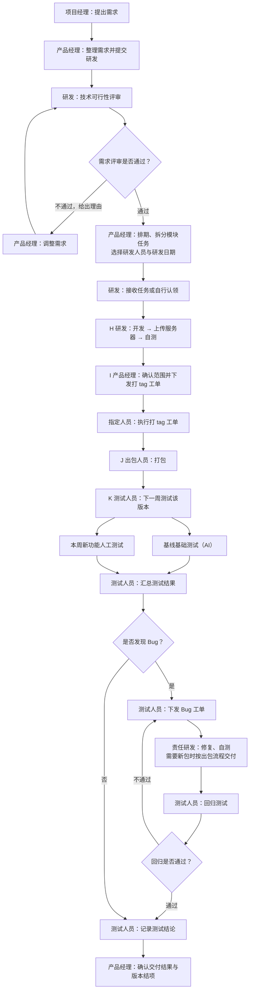
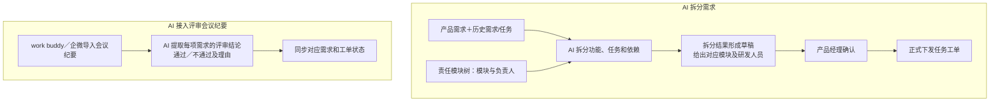
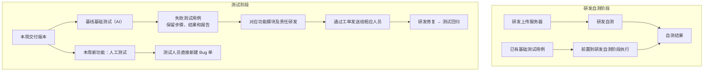
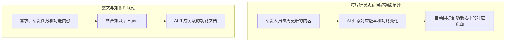
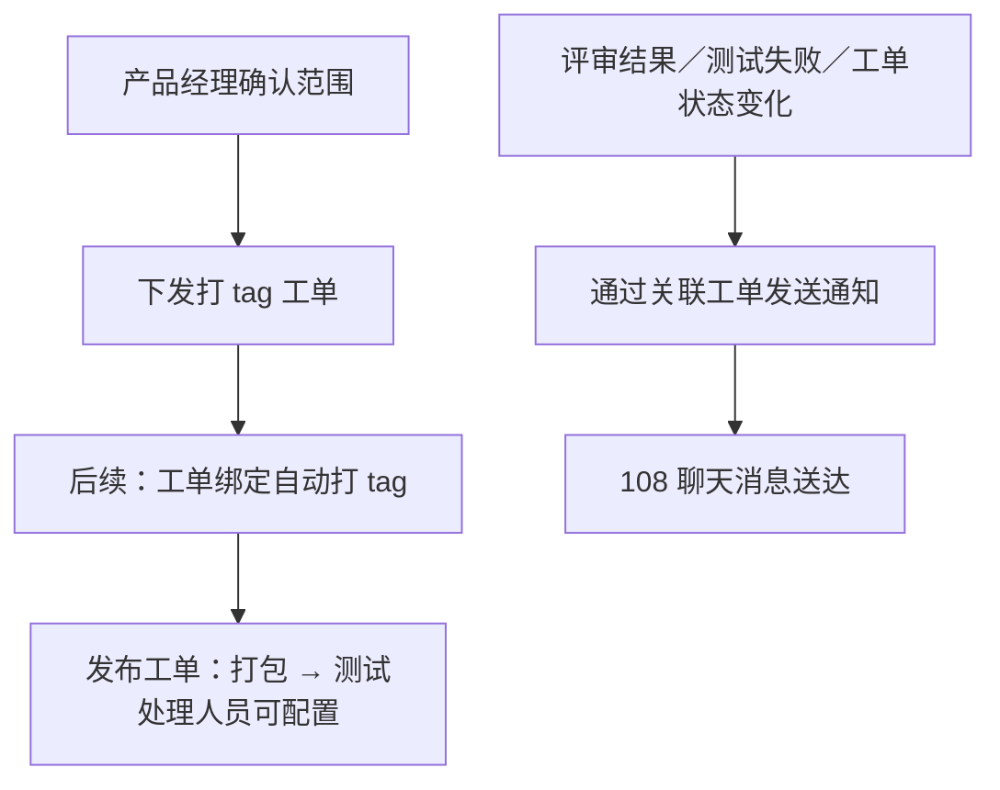

# USP产品开发和禅道功能AI优化方案

## 一、USP 产品开发主流程

# 二、需求整理、拆分与评审的 AI 优化

# 三、自测、基线测试与失败用例的 AI 优化

第一版先支持测试人员在 USP 页面直接新建 Bug 单；AI 测试后把失败用例通过工单发送给责任人员，放入后续迭代。

## 四、每周更新与功能文档的 AI 优化

## 五、会议中提出的工单自动化

自动打 tag 的顺序按本次补充执行：先由产品经理确认范围并下发工单，不在研发自测完成时直接触发。

## 六、AI 如何实现：两句话总结

AI 读取需求、会议纪要、责任模块树和测试结果，辅助拆分任务、提取纪要中的评审结论、分析失败用例，并生成每周更新和功能文档。需求拆分草稿由产品经理确认后下发，失败用例通过工单送达对应人员，研发周更新自动同步至功能拓扑页面。
