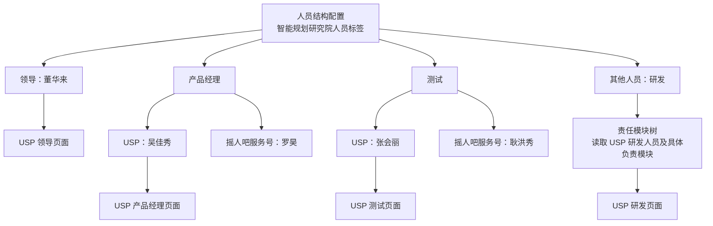
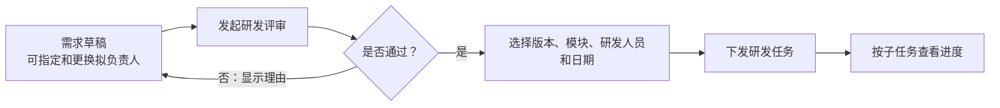
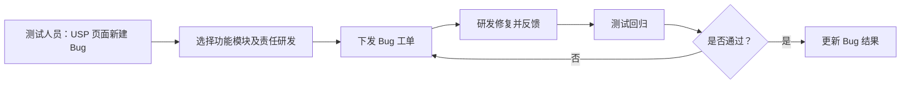
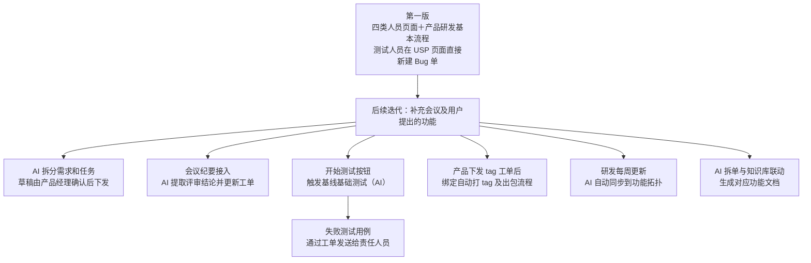

# USP分角色页面与迭代方案

## 一、人员标签与页面对应关系



人员标签从人员结构配置读取，岗位与对应人员可配置。本文件设计 USP 的四类页面，服务号产品经理和测试人员按上述名单配置。

## 二、四类页面共用的内容

```text
┌───────────────────────── USP 产品详情 ─────────────────────────┐
│ 姓名｜岗位名称｜负责模块                                       │
│ 工作周 [本周 ▼]              [历史版本]                        │
├────────────────────────────────────────────────────────────────┤
│ 本周开发版本：版本号、开发内容、进度                           │
│ 当前测试版本：版本号、测试内容、测试结果                       │
│ 版本相关 Bug：状态、负责人、修复情况                           │
├────────────────────────────────────────────────────────────────┤
│ 下方根据领导／产品／研发／测试显示不同模块                     │
└────────────────────────────────────────────────────────────────┘
```

## 三、第一版：领导页面

```text
┌────────────────────── USP｜董华来｜领导 ───────────────────────┐
│ 工作周 [本周 ▼]                   [历史版本]                   │
├─────────────────────────── 产品状态 ───────────────────────────┤
│ 需求评审进度｜研发进度｜打包状态｜测试状态                     │
├───────────────────────────┬────────────────────────────────────┤
│ 本周开发内容              │ 当前测试与 Bug                     │
│ · 需求及功能模块          │ · 基线测试结果                     │
│ · 负责研发人员            │ · 新功能人工测试结果               │
│ · 研发日期                │ · 版本相关 Bug                     │
│ · 完成情况                │ · 修复及回归状态                   │
├───────────────────────────┴────────────────────────────────────┤
│ 历史版本：版本号／功能变化／Bug／版本说明                      │
└────────────────────────────────────────────────────────────────┘
```

## 四、第一版：产品经理页面

```text
┌──────────────────── USP｜吴佳秀｜产品经理 ─────────────────────┐
│ 工作周 [本周 ▼]       [新建需求] [历史版本]         [版本注意点补充]           │
├─────────────────────────── 我的待办 ───────────────────────────┤
│ 待整理需求｜待评审｜待排期｜待确认 tag 范围                    │
├───────────────────────────┬────────────────────────────────────┤
│ 需求与任务                │ 本周版本                           │
│ · 草稿需求                │ · 纳入的需求与功能                 │
│ · 拟负责人筛选            │ · 关联研发任务                     │
│ · 评审结果及理由          │ · 自测完成情况                     │
│ · 模块子任务              │ · tag／打包／测试状态              │
│ · 负责人及日期            │ · 关联 Bug                         │
│ · 子任务完成比例          │ [确认范围并下发 tag 工单]          │
├───────────────────────────┴────────────────────────────────────┤
│ [拆分任务] [指派研发] [设置研发日期]                           │
│ 历史版本／需求文档／版本说明／升级配置说明                     │
└────────────────────────────────────────────────────────────────┘
```



## 五、第一版：研发页面

```text
┌────────────────── USP｜姓名｜研发｜负责模块 ───────────────────┐
│ 模块来源：USP 责任模块树                                       │
│ 工作周 [本周 ▼]            本周版本 [版本号]       [版本注意点补充]             │
├─────────────────────────── 我的待办 ───────────────────────────┤
│ 待评审需求｜本周研发任务｜待修 Bug｜tag 工单                   │
├───────────────────────────┬────────────────────────────────────┤
│ 本周研发任务              │ 前置工单与版本状态                 │
│ · 需求与模块              │ · 前置工单完成情况                 │
│ · 研发开始/结束日         │ · 自测状态                         │
│ · 当前任务进度            │ · tag／打包状态                    │
│ · 服务器上传记录          │ · 测试结果通知                     │
│ · 自测结果                │ · Bug 修复及回归结果               │
├───────────────────────────┴────────────────────────────────────┤
│ [认领任务] [更新进度] [登记上传] [提交自测]                    │
│ [处理打 tag 工单]                                              │
│ 需求文档／版本技术文档／负责模块的接口资料                     │
└────────────────────────────────────────────────────────────────┘
```

打 tag 入口对应产品经理已经下发的工单。研发自行认领的任务、指派任务和 Bug 都继续使用工单处理。

## 六、第一版：测试页面

```text
┌────────────────────── USP｜张会丽｜测试 ───────────────────────┐
│ 工作周 [本周 ▼]             版本 [版本号 ▼]                    │
├─────────────────────────── 我的待办 ───────────────────────────┤
│ 待测版本｜待测新功能｜待回归 Bug                               │
├────────────────────────── 测试包信息 ──────────────────────────┤
│ 版本／tag／打包状态／包位置／研发自测结果                      │
├───────────────────────────┬────────────────────────────────────┤
│ 基线基础测试（AI）        │ 本周新功能人工测试                 │
│ · 测试结果                │ · 本版功能清单                     │
│ · 失败用例                │ · 对应模块与研发人员               │
│ · 测试报告                │ · 测试记录与结果                   │
├───────────────────────────┴────────────────────────────────────┤
│ [新建 Bug 单]          [记录测试结果]                          │
├──────────────────────── 版本 Bug 列表 ─────────────────────────┤
│ Bug／功能模块／责任研发／状态／回归结果                        │
└────────────────────────────────────────────────────────────────┘
```

### 第一版必须支持：在 USP 页面直接新建 Bug 单

```text
┌───────────────────────── 新建 Bug 单 ──────────────────────────┐
│ 所属产品：USP                                                  │
│ 发现版本：[当前测试版本]                                       │
│ 功能模块：[选择模块]                                           │
│ 责任研发：[对应人员]                                           │
│ Bug 标题：[填写]                                                                       │
│ 附件／截图／测试报告：[bug内容]                                   │
│                          [下发 Bug 工单]                       │
└────────────────────────────────────────────────────────────────┘
```



## 七、后续功能迭代


