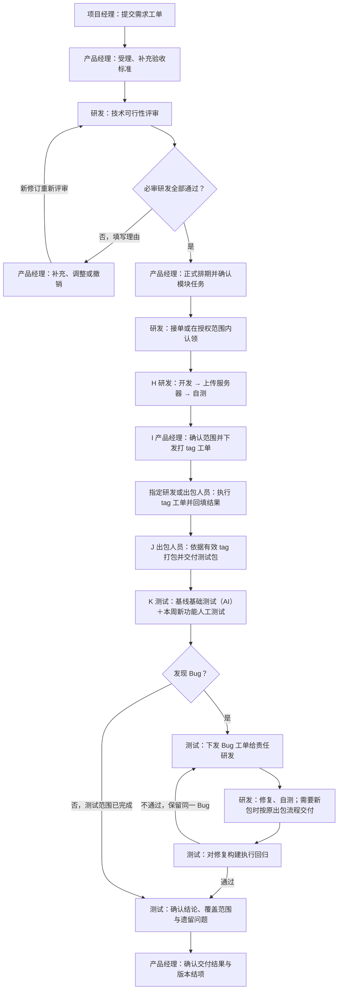
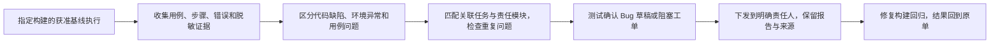

# USP 禅道迁移与分角色工作台方案

| 文档信息 | 内容 |
|---|---|
| 版本与日期 | V1.0，待评审；2026-11-26，Asia/Shanghai |
| 设计依据 | 两份会议纪要、用户本次补充，以及当前摇人吧服务号仓库 |
| 核心目标 | 把 USP 的需求、研发、出包、测试和 Bug 闭环迁到摇人吧，首版先跑通流程，再逐步增加 AI |
| 设计入口 | 后台管理 → 项目管理 → USP 产品详情；不改变普通客户项目详情 |
| 交付边界 | 仅产品设计，不实现页面、接口、自动化任务或线上人员配置 |

## 一、结论与范围

首版不复制一套完整禅道，而是在现有摇人吧中补齐产品研发流程。工单继续承载任务和通知，USP 页面负责汇总同一份数据，并根据人员标签展示四种角色视图。

本方案把改动收敛为三个模块：人员与职责配置、工单与派单、项目管理中的产品工作台。功能拓扑继续使用原内容服务；研发流程迁移需要补充后端业务关联，不能仅靠更换前端页面完成。

### 1.1 本次统一的取舍

| 事项 | 本次口径 |
|---|---|
| 流程冲突 | 用户最新补充优先，其次为两份会议纪要；未冲突部分沿用原 USP 方案 |
| 自测与出包 | 研发先开发、上传服务器并自测；产品确认范围后下发 tag 工单；有效 tag 就绪后出包 |
| 自动打 tag | 不采用“自测完成即打 tag”；后续自动化也必须由产品确认后的 tag 工单触发 |
| 测试 | 同一测试构建分别记录基线基础测试（AI）与本周新功能人工测试，不能互相替代 |
| 第一版 Bug | 测试人员必须能在 USP 页面直接新建并下发 Bug 单；AI 失败用例派单后续接入 |
| 历史禅道 | 不全量迁移历史；新流程先切换，历史保留查询及原单链接 |
| 请假、值班与工时表 | 按会议结论暂缓，不进入本次 V1；旧方案相关章节保留为远期设想，不视为当前必做项 |
| 文档与接口 | 首版关联需求文档、版本技术文档及有权限的接口资料，不复制 Apifox 或公开内部接口 |

### 1.2 首版必须能跑完的闭环

产品经理可以整理需求并发起技术评审，研发通过评审后接单开发，测试可以提 Bug 并跟踪修复和回归。产品经理最终能够对照版本范围确认本轮交付结果，而不是只看到“工单已结束”。

页面上的每个任务、待确认事项及业务通知都能进入关联工单。108 聊天、企微或其他消息渠道只负责送达工单消息，不另建一套无法回溯的任务流。

## 二、人员标签与角色判定

### 2.1 配置来源与首批人员

在现有“用户管理 → 人员结构配置”中增加研究院标签和产品角色配置。人员所属组织、姓名及账号读取现有资料，USP 研发负责的模块读取责任模块树，不维护第二份模块名单。

| 人员范围或姓名 | 配置标签 | 产品范围 | 默认页面 |
|---|---|---|---|
| 董华来 | 智能规划研究院、领导 | 授权的 USP、ORS | 领导视图 |
| 吴佳秀 | 智能规划研究院、产品经理 | USP | USP 产品视图 |
| 张会丽 | 智能规划研究院、测试 | USP | USP 测试视图 |
| 罗昊 | 智能规划研究院、产品经理 | 摇人吧服务号（ORS） | ORS 产品视图 |
| 耿洪秀 | 智能规划研究院、测试 | 摇人吧服务号（ORS） | ORS 测试视图 |
| 研究院内除上述人员外的其他人员 | 智能规划研究院、研发 | 按实际产品成员及模块配置 | 对应产品研发视图 |

以上姓名是用户指定的初始化名单，不是代码中的权限判断条件。管理员首次启用时确认实际账号 ID、所属组织和产品绑定；重名、账号缺失或组织信息不符时先提示核对，不按姓名自动授权。

“其他人员默认研发”只适用于已确认的研究院组织范围，不适用于全公司。产品经理或测试如需兼任研发，需要显式增加标签及产品范围，不能因为访问其他产品就自动获得研发职责。

### 2.2 进入 USP 页面的判定顺序

1. 系统读取当前登录账号和人员结构配置，确认是否属于配置的研究院组织范围。
2. 系统读取该人员在 USP 范围内的有效角色，显示“姓名｜岗位｜产品｜负责模块”。
3. 对研发，系统根据责任模块树的 USP 产品节点和工程师账号 ID，获取“产品 → 界面 → 功能”职责。
4. 系统按角色、模块和本人工单生成待办，默认进入对应视图；兼任人员可以切换已有授权的视图。
5. 角色决定页面展示，后端仍校验产品数据范围及操作权限，隐藏按钮不能代替鉴权。

ORS 的产品经理、测试标签不自动变成 USP 的对应权限。非研究院用户继续使用现有页面或被明确授权的只读入口；USP 模块为空的研发显示“尚未配置负责模块”，但仍可处理已合法指派给本人的工单。

出包人员不是第五种角色页面，而是可配置的任务执行职责。被指定的研发或出包执行人，在自己的工作台中看到 tag、打包及交付工单。

## 三、USP 产品主流程

### 3.1 调整后的主流程



本周研发和上周版本测试继续并行展示，默认在下一周测试已经交付的指定构建。测试受阻时保留进行中的测试工单，不能走“未发现 Bug”分支直接结项。

### 3.2 H、I、J、K 的交接标准

| 节点 | 必须完成的动作 | 交给下一环节的证据 |
|---|---|---|
| H 研发 | 先上传到约定的研发自测服务器，再验证上传的候选内容；不通过则继续处理 | 需求及任务清单、提交标识、候选记录、环境及文件位置、自测结果 |
| I 产品经理 | 确认本次纳入与顺延范围、已知风险，再下发 tag 工单 | 已确认范围、准确代码基线、执行人和截止时间 |
| tag 执行 | 指定人员对确认的提交执行 tag，回填结果；首版可人工执行 | 仓库、提交标识、唯一 tag、执行记录，且与 H 的候选基线一致 |
| J 出包人员 | 核对有效 tag，打包并登记可获取的测试包 | 版本、不可覆盖的构建号、tag、包位置及校验值、交付时间 |
| K 测试人员 | 对同一明确构建分别执行基线与新功能测试，记录各自结论 | 环境、构建、基线用例范围及报告、新功能人工测试记录、Bug 清单 |

H 上传的是研发自测候选内容，J 交付的是正式编号的测试包。候选内容发生变化时需要更新记录并重新自测；测试包发布到服务器或制品库只是交付，不代表已经生产上线。

K 中的“AI”指辅助维护用例、分析结果及对接既有执行器，不是让模型凭文字判断测试通过。首版允许登记外部基线任务与报告；USP 用例、执行环境或执行器未接通时显示“未接入/未执行”，不能显示通过。

### 3.3 保留的流程约束

- 技术评审通过后才正式排期；研发可提出子任务，产品经理确认范围、版本和日期后下发。
- 每项执行任务只有一名当前处理人，多模块协作拆成子工单；工单关闭不自动等于业务验收通过。
- 研发提交修复后进入待回归，由测试确认结果；回归失败退回同一 Bug，不重复建单。
- 产品经理确认版本结项；阻塞缺陷必须处理，允许保留的低风险问题按原风险工单规则确认，不默认转交领导逐项审批。
- 保留有理由的退回和重开。已出包后发生范围变化时创建新修订或新构建，不改写原 tag、测试结论和历史快照。

## 四、可以用 AI 优化的环节

| 环节 | AI 可以优化的内容 | 人工或系统边界 | 建议阶段 |
|---|---|---|---|
| 需求整理与评审 | 从需求及会议纪要提取背景、验收项、待确认点和评审意见 | 产品确认需求稿；技术结论由必审研发确认，AI 不自动判定通过 | V1.2 |
| 拆分任务 | 根据模块职责给出子任务、依赖和候选负责人 | 产品审核后下发，研发认领仍受模块和账号权限限制 | V1.2 |
| 研发自测 | 推荐本次变更相关的基础或接口用例，解释失败证据 | 仅执行适用且获准的用例，研发确认结果；接口自动化不直接等同单元测试 | V1.1 |
| 基线基础测试 | 辅助补充候选用例，通过既有执行器运行获准的基线集 | 用例须审核，报告必须绑定实际环境和构建；人工新功能测试仍保留 | V1.1 |
| 失败用例处理 | 归类代码缺陷、环境异常和用例问题，给出责任模块及 Bug 草稿 | 测试首阶段确认后发送；环境故障不直接归责研发 | V1.1～V1.2 |
| 版本说明 | 汇总本版新增、修复、已知问题及现场升级配置步骤 | 产品、研发核对后交付，不把开发完成写成已上线 | V1.2 |
| 功能拓扑周更新 | 按工单、版本及模块生成更新差异，同步到授权节点 | 保留来源与人工修改，冲突或敏感信息转确认工单 | V2 |

AI 实现总结（两句话）：系统把有权限的需求、工单、模块职责、代码证据和测试报告按产品、版本及构建组织成上下文，由 AI 生成可追溯的拆单建议、测试分析和文档差异，再交给现有工单流程处理。需要确认的内容先形成草稿或确认工单，只有满足明确授权、可靠映射及结果校验的更新才自动执行，技术评审、版本范围和最终测试结论仍由对应责任人确认。

自动打 tag、打包和通知重试属于确定性流程自动化，不必由 AI 决策。后续执行器应消费产品已确认的工单，校验提交、权限和执行结果，失败时停留在原阶段。

## 五、禅道迁移：三个模块分别改什么

### 5.1 最小改造清单

| 摇人吧模块 | 当前可以复用 | 第一版需要增加或调整 |
|---|---|---|
| 人员与职责配置 | 人员结构、公司部门、账号、角色权限、责任模块树及工程师绑定 | 配置研究院标签、四类角色及产品范围；初始化指定人员；把 USP 模块职责读到页面，并提示缺失配置 |
| 工单与派单 | 创建与指派、Bug 类型、讨论及 @、附件、处理记录、阶段处理、父子/前置/重复关联、通知基础设施 | 明确需求单、研发任务单、Bug 单和发布任务；增加草稿及拟负责人、产品/版本/模块/构建关联和评审结果；补齐产品范围的任务汇总、tag/出包/测试交接与 Bug 回归 |
| 项目管理／产品工作台 | 项目入口、项目详情、项目工单统计及信息资料入口 | 区分产品型与客户现场型项目；新增 USP 分角色周视图、需求池、版本与构建、测试与 Bug、历史版本及文档资料，不重新维护另一套任务数据 |

现状判断以当前仓库为准，不代表线上已经部署全部能力。现有 Bug 类型可以直接复用；部分界面已把 feature 展示为“需求”，但这不等于已具备完整需求评审和版本流程，实施时需要统一分类及文案。

### 5.2 工单和版本的关联方式

| 业务内容 | 组织方式与首版规则 |
|---|---|
| 需求单 | 产品经理维护父工单；草稿可指定“拟负责人”，未正式下发时不占待认领任务，也不发送执行通知 |
| 研发任务 | 按模块建子工单，一单一名处理人；产品确认排期后可指派或在授权池认领，研发也可提出待确认的子任务 |
| 发布任务 | 每次测试构建建立发布工单，关联 tag、打包、交付和测试的阶段工单；各阶段执行人与截止时间可配置 |
| Bug 单 | 复用现有缺陷工单，独立记录发现构建、模块、修复构建和回归结论，关联需求或研发任务 |
| 版本与构建 | 版本汇总需求、任务和 Bug；每次出包产生独立构建，不用修改旧包来表示修复 |
| 文档资料 | 需求文档、研发技术文档分别分类并关联版本；版本说明包含现场配置调整、升级前提和已知限制 |

一个子工单仍只属于一个父工单。版本、发布构建及来源项目通过独立关联引用任务，不为了放进多个列表给同一任务重复设置父级。

现有工单关联已经支持父子和前置，但默认子工单不阻塞父工单结束，前置主要限制解决或关闭。首版需增加 USP 产品流程校验：纳入范围的子任务都有有效结果，或经产品明确剔除后，父需求才能结项；未完成前置的依赖任务不能被误记为就绪。

该校验不直接修改影响全公司的全局关联开关。已取消的子单不能自动算作交付完成，剔除、改派及依赖变更都要保留理由和操作记录。

工单通用状态保持兼容，评审、自测和测试等业务阶段单独表达。已有已解决、关闭等状态不能直接映射成“技术评审通过”或“测试通过”。

### 5.3 切换步骤

1. 管理员确认研究院账号、产品角色、USP 模块负责人及各阶段执行人，产品经理核对当前版本与待办范围。
2. 选择一个 USP 周迭代试运行，只录入或选择性迁入本轮未结需求、任务和 Bug，并保留禅道来源类型、原 ID 及链接。
3. 对选入对象登记切换点，后续只在摇人吧处理；未切换的历史对象仍按原方式管理，不进行无规则双向编辑。
4. 跑完需求、评审、研发上传自测、确认 tag、出包、双线测试和 Bug 回归，核对人员待办、版本范围及通知是否一致。
5. 试运行稳定后扩大到后续 USP 迭代，再按单独确认的流程复用到 ORS；历史数据分批只读导入，不作为首版前提。

重复导入按“来源系统、产品、对象类型、原 ID”识别，账号、状态和附件映射先核对再导入。试点异常时保留摇人吧记录及 ID 对照，暂停扩大范围；确需切回时逐单确认处理位置，不能清空记录后在禅道重复建单。

## 六、四类角色的第一版 USP 页面

### 6.1 共用框架：相同事实，不同任务入口

所有视图共用姓名岗位条、工作周选择、开发版本、在测版本与构建。切换工作周只改变筛选，不重置历史工单、测试进度或 Bug；同一对象从哪个角色进入，状态和记录都一致。

```text
USP 产品工作台                         工作周 [本周 ▼] [历史版本]
姓名｜研究院岗位｜当前产品角色｜负责模块     [切换已授权视图]
本周开发：版本／进度     当前测试：版本／构建／测试进度
角色专属待办 → 角色专属业务区 → 共用版本、资料和活动记录
```

版本编号沿用原方案：年、月、月内周版本三段从 0 计数，月首周末位归 0，跨年首位递增、月位归 0。编号基准年及跨月归属按已有历史核对后配置；示例 2.10.3 不代表已经核实的当前线上版本。

| 内容 | 领导 | 产品经理 | 研发 | 测试 |
|---|---|---|---|---|
| 版本、进度及质量事实 | 授权汇总 | 本产品全局 | 本产品获准范围及关联项 | 本产品测试范围 |
| 需求与评审 | 查看风险 | 整理、发起、排期 | 处理本人评审、提出任务 | 查看验收标准 |
| 研发与自测 | 查看阻塞 | 跟踪、确认范围 | 执行本人任务及自测 | 查看交付证据 |
| tag 与出包 | 查看结果 | 确认范围并下发 | 仅指定执行人操作 | 查看测试包 |
| 测试与 Bug | 查看质量风险 | 查看、协调 | 修复本人 Bug、查看相关结果 | 登记测试、直接提 Bug、回归 |
| 文档与拓扑 | 查看获准资料 | 维护需求及版本说明 | 维护技术资料、查看负责模块 | 查看验收及测试资料 |

电脑端采用“待办主区＋版本状态侧栏”，手机端按同样顺序纵向显示，核心按钮不依赖悬停。功能拓扑继续提供手机双指缩放、点击节点及桌面查看入口，内容编写与保存仍走原服务；复杂批量排期优先在电脑端完成。

### 6.2 领导页面：看交付、质量与需要决策的事项

董华来进入 USP 后默认看到产品总览，可在有权限时切换 ORS。领导页面不默认展示个人工时、请假信息，也不把全部技术评审和日常派单变成领导审批。

```text
董华来｜领导                     产品 [USP ▼]   工作周 [本周 ▼]
本周开发进度｜当前在测构建｜阻塞 Bug｜延期与风险
[需要我决策的工单]                [本周交付状态]
事项／影响／提出人／期限            评审 → 研发 → 出包 → 测试
[重点需求与质量风险]              [版本历史与升级说明]
```

- 默认待办只包括明确指派给本人的决策、资源协调和升级工单，没有事项时显示“暂无待决策”。
- 版本卡同时呈现基线测试与新功能测试的完成情况，不用一个总通过率掩盖未测范围。
- 点击延期、风险或 Bug 数量，进入同口径工单列表；本页不提供默认的正式排期、tag 或测试通过按钮。

### 6.3 产品经理页面：把需求推进到本周可交付范围

吴佳秀进入 USP 后默认看到产品视图；罗昊在 ORS 使用相同框架，但数据和人员范围按 ORS 隔离。首版先支持手工整理与拆分，AI 拆单不作为流程启动条件。

```text
吴佳秀｜USP 产品经理              [+新建需求] [历史版本]
待受理｜待发评审｜待排期｜待确认出包｜待确认交付
[本周需求与研发任务]               [版本交付侧栏]
需求／模块／负责人／日期／进度      自测候选 → tag → 测试包 → 测试
[草稿池：拟负责人／优先级筛选]      [确认范围并下发打 tag 工单]
[评审结论与讨论]                  [开放 Bug／顺延事项／升级配置]
```

- 需求卡展示父需求和模块子任务，允许研发提出子任务，产品经理确认版本、人员、日期及依赖后下发。
- 草稿池可按拟负责人筛选，但草稿数量不等同真实工作负荷；人员占用先依据已下发任务与计划日期判断，不引入请假表推算。
- 需求卡展示“本版纳入任务完成数／本版纳入任务总数”，并单独显示通过自测和测试的状态，不把任务数量比例当成交付质量。
- 出包侧栏逐项展示候选基线、自测证据、范围变更和已知风险，确认后下发 tag 工单，不提供绕过评审与自测的快捷发布。
- 历史版本可查看功能、Bug、技术资料和升级配置说明；产品经理可以维护现场升级前提，不能用上传状态代替上线记录。

### 6.4 研发页面：只把本人需要处理的内容放在前面

研发进入后优先看到本人本周任务、技术评审及待修 Bug，并显示责任模块树中的具体负责模块。模块范围是职责依据，当前执行责任仍以工单处理人为准，不因模块负责人变动自动改派进行中任务。

```text
姓名｜研发｜USP｜负责模块 [责任树中已绑定的模块]
待我评审｜本周任务｜待修 Bug｜等待前置完成
[我的研发任务]                    [本周版本与交付状态]
模块／期限／前置／上传候选／自测    产品确认 → tag → 打包 → 测试
[更新进度] [登记上传] [提交自测]    [指派给我的 tag／出包工单]
[可认领任务] [我的 Bug]            [需求文档／版本技术资料]
```

- 任务卡直接进入原工单，记录上传的服务器环境、候选标识与自测结果，不要求再写一套独立周报。
- 前置任务未就绪时明确显示阻塞原因、对应工单和负责人；不能仅因到了计划日期就显示可交付。
- 待认领池只展示符合产品、模块与资格范围的任务，认领不修改已确认版本和研发日期。
- 普通研发没有默认“打 tag”按钮；收到产品已确认的指定执行工单后，才显示回填 tag 结果入口，首版不承诺按钮直接操作仓库。
- 测试反馈和待回归结果关联原 Bug，研发提交修复构建和证据后等待测试确认，不能自行将 Bug 记为回归通过。

### 6.5 测试页面：先明确测哪个包，再记录结果和直接提 Bug

张会丽进入 USP 后默认看到待测版本；耿洪秀在 ORS 使用同类测试视图。测试包是否可用、基线是否执行、新功能是否完成要分开展示，不用一个“测试中”标签覆盖全部信息。

```text
张会丽｜USP 测试                  [测试周 ▼] [版本／构建 ▼]
待开始测试｜基线未通过项｜待回归 Bug｜测试受阻
[待测版本与测试包]                [本周新功能清单]
tag／包位置／校验／研发自测记录     需求／模块／责任研发／验收标准
[基线基础测试：记录与报告]         [新功能人工测试：逐项结果]
[登记基线结果] [记录人工测试]      [+新建 Bug] [我的回归任务]
[本构建 Bug 台账：模块／状态／处理人／修复构建]
```

- V1 必须提供页面级、功能行和测试记录行的“新建 Bug”入口，创建时自动带入当前 USP、版本、构建及可确定的模块。
- 基线报告可来自已有脚本或外部测试任务，首版登记运行标识、覆盖范围、通过/失败/跳过/受阻及报告链接；本页暂不假装已经具备一键执行能力。
- 人工测试逐项关联本周需求及验收标准，结果使用未执行、通过、失败、受阻等明确状态；失败可直接建 Bug，环境问题先登记阻塞。
- 测试人员可以直接下发本人有权限产品内的 Bug，不经过产品经理二次批准；提交成功后同时出现在系统任务及 USP Bug 台账，使用同一工单 ID。
- 基线和人工测试范围完成后，测试提交总结；未测、失败、受阻及遗留 Bug 明确显示，最终由产品经理按交付规则确认版本结项。

## 七、测试页提 Bug 与 AI 失败用例派单

### 7.1 第一版 Bug 创建表单

点击“新建 Bug”后使用侧栏或手机全屏表单。测试人员不离开当前版本上下文即可填写、确认责任人并下发，成功后保留当前筛选及测试位置。

| 字段 | 首版规则 |
|---|---|
| 标题与所属产品 | 标题必填；产品从当前 USP 带入，切换产品需要相应权限并重新选择关联数据 |
| 发现版本、构建与环境 | 必填，默认当前测试对象；历史版本问题可以主动选择，不能套用当前构建 |
| 功能模块与关联任务 | 模块必选，关联任务可选；无法确定模块时明确选“待确认”，转配置的责任确认人 |
| 复现步骤 | 必填，支持直接带入当前人工测试项或后续的失败用例步骤 |
| 预期与实际结果 | 分别填写，不能只写“测试失败” |
| 严重程度与优先级 | 分开选择；阻塞、严重等等级与处理优先级有明确含义 |
| 责任研发与期限 | 推荐后由测试确认；候选不唯一时必须选择或转责任确认，不随机派发 |
| 证据 | 支持截图、脱敏日志、附件和有权限的报告链接，不写入密码或服务器凭据 |
| 来源记录 | 保留新功能测试项、基线运行或手工发现等来源；手工创建不强求存在自动化用例 ID |

责任人推荐依次参考可确认的关联研发任务处理人、责任模块树负责人和配置的产品研发兜底人。多负责人时由测试选择；无法判断时交给配置的责任确认人，不将责任不明问题直接归到任意研发。

提交前提示可能重复的未关闭 Bug，测试可以关联原 Bug 并补充本次证据。研发修复后进入待回归，测试对明确的修复构建验证；同一问题回归失败继续使用原 Bug。

### 7.2 后续：AI 测试失败到责任工单



首次接入采用“生成草稿 → 测试确认下发”，不把每个失败用例直接变成研发 Bug。环境故障转测试环境处理工单，用例或预期错误转用例维护工单，映射不清的失败进入责任确认。

失败记录至少包含产品、版本、构建、运行 ID、用例 ID、错误指纹、环境、步骤、预期、实际和报告链接。同一运行事件重放不重复建单，后续运行再次出现已知未修问题时，先关联原 Bug 并追加证据。

映射完整、分类稳定且获得明确授权后，可逐步启用特定范围的自动派单。AI 不能借测试日志改变权限、擅自公开敏感数据或修改人工测试结论；最终回归结果仍由授权测试人员确认。

## 八、分期实施与首版验收

### 8.1 迭代顺序

| 阶段 | 主要交付 | 暂不包含／进入下一阶段的条件 |
|---|---|---|
| V1：低配闭环 | 研究院标签及四角色页面；需求草稿、评审、任务拆分与认领；上传自测记录；产品确认 tag；人工执行 tag/出包并登记；基线报告与人工测试记录；测试页直接提 Bug、修复回归；版本历史和文档关联 | 不新建 AI 测试平台，不做 AI 自动派单、自动操作仓库或历史全量导入；先跑完一轮真实 USP 迭代 |
| V1.1：测试联动 | 在已有 USP 用例、环境及执行器确认可用后增加“开始基线测试”、异步状态与报告回传；按影响范围辅助研发自测；失败用例生成 Bug 或阻塞草稿并由测试确认下发 | 不把摇人吧自身的自动化套件当作 USP 套件；没有运行结果不能显示测试通过 |
| V1.2：协同提效 | AI 整理会议纪要、需求拆分与负责人建议、版本说明草稿；产品确认后触发的 tag 校验及出包自动化 | 评审结论、范围、派单及文档内容保留相应确认和审计；自动化失败可退回人工处理 |
| V2：受控自动同步 | 授权范围内的拓扑周更新、稳定失败类型自动派单、历史数据分批导入及趋势分析 | 请假、值班、人员工时表和题目生成仍为单独待确认事项，不因进入 V2 自动恢复为需求 |

阶段名称表达功能顺序，不承诺研发工期。V1 不以 AI 功能全部接通为前提，但不能缺少测试人员直接提 Bug 和回归闭环。

### 8.2 V1 验收清单

1. 董华来、吴佳秀、张会丽分别进入 USP 的领导、产品、测试视图；罗昊和耿洪秀的对应角色限定在 ORS，不能借标签越权操作 USP。
2. 研究院其他研发按人员结构与 USP 责任模块树看到负责模块、本人评审、任务及 Bug；缺失配置有明确提示，不扩大权限。
3. 产品经理能够保存带拟负责人的需求草稿、发起研发评审，并在评审通过后确认版本、日期和模块子任务。
4. 父需求不能因为单个子任务完成而结束；阻塞、取消和顺延均有明确结果，普通客户项目既有规则不受影响。
5. 研发按照开发、上传服务器、自测的顺序登记证据，产品确认范围后才下发 tag 工单，打包使用一致的有效 tag。
6. 同一周能够同时查看本周研发与上周测试，所有测试结果和 Bug 绑定准确构建，换周不丢失未完成事项。
7. 测试人员能够从 USP 页面直接新建并下发 Bug，自动带入上下文、确认责任人，并能在统一工单系统找到同一条记录。
8. 基线与新功能测试分别展示，未接入、未执行、跳过、失败及受阻不被汇总为通过；首版外部报告有可访问的记录。
9. Bug 修复后由测试回归，同一问题不因每次失败重复建单；版本结项明确开放问题和升级配置说明。
10. 角色、模块和工单权限在后端一致校验，通知关联实际工单；重复操作不重复生成同一轮任务或消息。

## 九、依据与待配置项

### 9.1 本稿核对的依据

- 会议纪要：《禅道迁移方案.md》《USP针对不同角色的页面设计.md》；原设计：《USP产品工作台产品设计文档.md》。会议原文未改写。
- 人员与模块：`frontend/src/pages/admin/OrgChart.tsx`、`backend/app/models/identity.py`、`backend/app/models/module_tree_node.py`。当前有组织、职级、汇报关系及模块工程师绑定；职级不是本稿的四类产品岗位标签。
- 工单与关联：`backend/app/models/task.py`、`backend/app/modules/tasks/api/task.py`、`backend/app/modules/tasks/services/task_policy_service.py`。已有 Bug、父子、前置和重复关联，不需重新开发基础关系，但需要补充产品业务规则。
- 页面与通知：`frontend/src/pages/admin/ProjectDetail.tsx`、`frontend/src/pages/admin/AdminEntries.tsx`、`backend/app/services/notification_outbox_service.py`。当前项目入口和工单通知基础可复用，本稿的分角色工作台及完整版本流程属于新增设计。
- 测试能力边界：仓库自动化测试平台说明包含 Excel、pytest、Allure 和工单驱动候选用例生成；本次未执行测试流水线，也未核实 USP 专用执行器、真实环境和基线用例已接通。

### 9.2 实施前需要配置，不阻塞本稿评审

| 待配置项 | 需要确定的内容 |
|---|---|
| 人员与产品 | 研究院对应的组织范围、指定人员账号 ID、产品项目映射；USP 的实际研发人员和模块读取责任树核对 |
| 服务器与出包 | H 的研发自测环境、候选记录方式、tag 执行人、打包人员和制品交付位置；不把历史会议中的人员昵称写成固定规则 |
| 测试接入 | USP 既有基线用例、执行器、真实测试环境、报告地址、脱敏规则与结果回传方式；不以 Mock 测试替代真实构建验证 |
| 周期与通知 | 版本编号基准、周出包窗口、默认测试开始日及工单送达渠道；108 聊天的接入条件需单独核实 |

本次仅新增整合设计，并同步修订原方案中相关流程文字；未修改业务代码、会议纪要、线上需求或人员配置。
