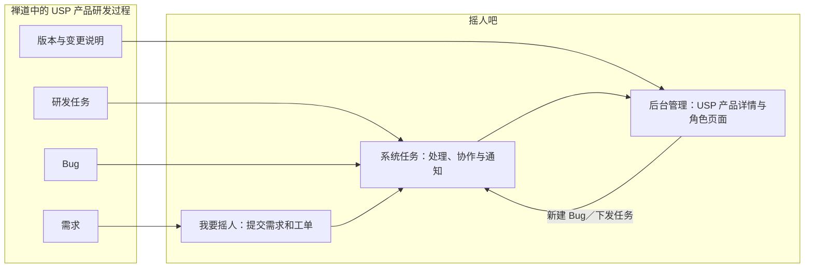
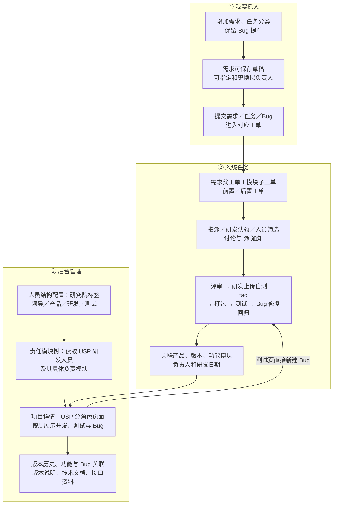
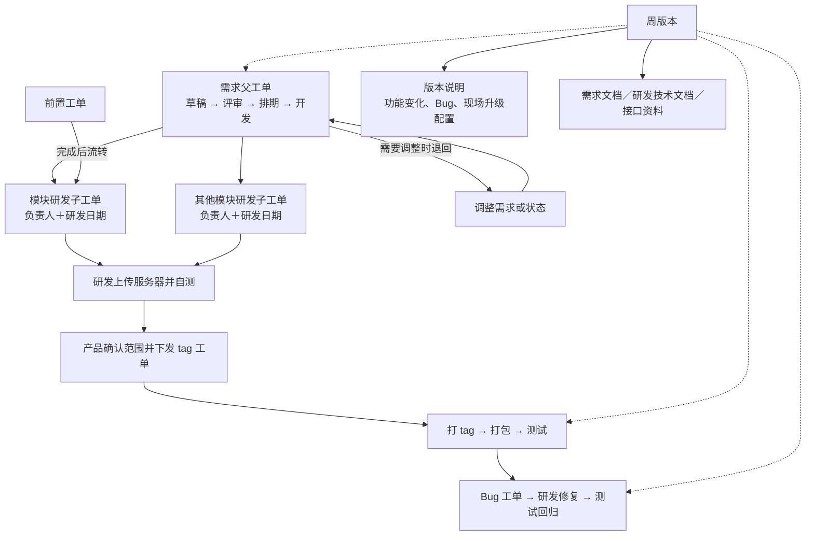
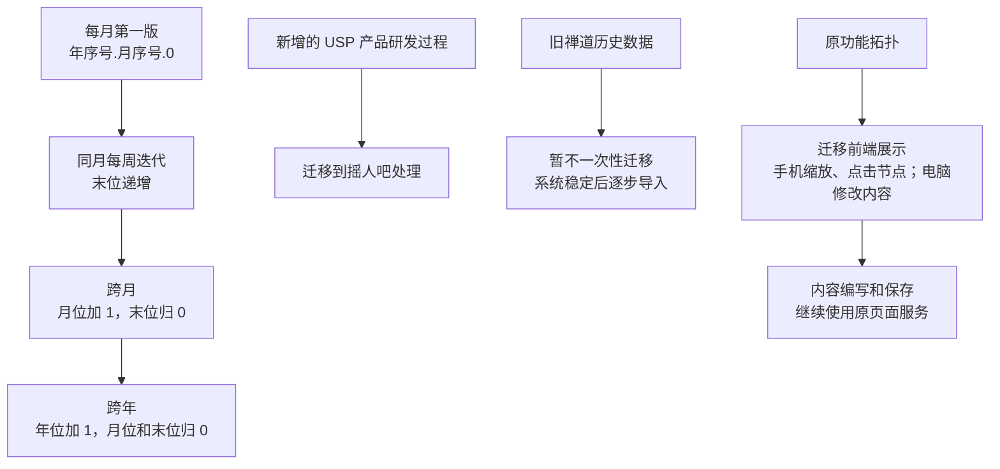

# 禅道迁移到摇人吧方案

## 一、迁移内容

## 二、三个模块分别更改的地方

三个模块中的任务和通知均使用工单；USP 页面显示同一批工单的产品状态、开发内容和 Bug 内容。父子工单及前后置关联沿用现有能力，补齐 USP 流程中的交接。

## 三、需求、任务、版本与 Bug 的关系

## 四、版本与历史内容

接口资料按会议纪要处理：内部接口不直接公开集成，先关联技术文档中的接口信息或按模块、岗位查看的接口资料。
