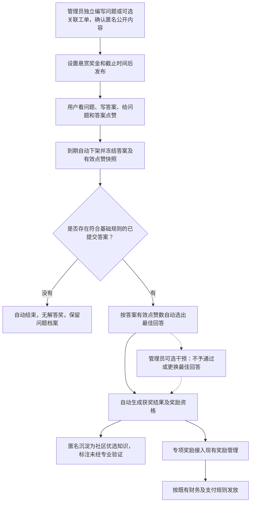

# 高价值问题联合攻坚专区完整方案

> 2026-10-26 需求调整：取消回答者匿名展示。答案列表、最佳解答、管理员选择最佳回答及社区优选结果统一展示回答者的用户显示名（优先 `name`，为空时使用 `username`；账号不存在时显示“未知用户”），历史已发布答案同样适用，不新增迁移。回答前明确提示会展示用户名。问题提问人、发布管理员及正文敏感信息继续按原规则保护，草稿仅本人可见，点赞、评奖、奖励和实名人员榜规则不变。下文关于“解答人持续匿名”“答案使用匿名编号”的原始设计以本次调整为准。

## 1. 文档信息与结论

| 项目 | 内容 |
|---|---|
| 版本 | V1.3，代码实现对照稿（待部署） |
| 编制日期 | 2026年10月20日 |
| 所属模块 | 后台管理的知识管理区域，知识贡献榜下方 |
| 对外名称 | 高价值问题榜单 |
| 业务定位 | 由平台组织解决长期未解决、影响面大、具有共性的复杂问题 |
| 设计原则 | 后台发布及出资；用户看题、看奖金、写答案、点赞；到期自动评奖，管理员按需干预 |
| 实施状态 | 已完成核心业务、前端及隔离测试；新增模型与迁移文件，未执行真实环境迁移、生产部署或真实派奖；原财务审核及支付模块未改动 |

**核心方案：管理员可独立发布高价值问题，也可选择关联已有工单，设置悬赏奖金及截止时间；用户匿名解答并为问题和答案点赞；到期自动按答案有效点赞数选出一名获奖者，不经过专业审核。管理员可不予通过或更换最佳回答，奖金沿现有奖励管理流程发放。**

“自动获得奖励”指自动确定获奖资格和金额，不等于截止瞬间微信到账。高价值问题不再设置内容审核、审核意见、专家采纳或管理员逐题确认步骤；现有财务审核、转账及提现规则不变。

### 1.1 完整流程概览

管理员干预为例外操作，不是自动评奖的前置审批。开奖、知识沉淀与资金实际到账分别记录状态。

## 2. 已确认范围与方案建议

### 2.1 已确认的业务边界

1. 高价值问题由后台发布，支持独立发布和关联已有工单两种来源，工单关联为可选；用户不申请上榜、不自行发布、不自设悬赏。
2. 每题有悬赏奖金及截止时间，用户可直接看到金额；过期从进行中和首页前三名中下架。
3. 用户可直接写答案，为问题和答案点赞；公开提问人、解答人继续匿名。
4. 不经过专业审核，到期按答案点赞排名自动确定获奖者；管理员可不予通过或改换最佳回答人选。
5. 前端提供状态变更按钮，仅超级管理员、管理员可见，服务端同时校验身份及合法状态转换。
6. 管理方主要操作为发布问题及奖金、处理问题状态、在现有奖励管理中处理最终发放。
7. 在知识管理区域的知识贡献榜下方新增高价值问题榜单，仅预览前三名，详情列表展示完整内容。
8. 复用原有卡片、标题、颜色、圆角和间距，不改原知识贡献榜及奖励卡片UI。
9. 不改变现有财务审核、自动审核策略、权限、奖励状态含义、转账或提现规则。
10. 知识沉淀月份统一按提问时间计算：关联工单取原工单提问时间，独立问题取首次正式发布时间；均不按截止、选奖或发奖时间计算。

### 2.2 为完整实现采用的建议默认值

下列为建议，尚未确认的细节在第19节集中列出，不能当作已实现规则。

| 项目 | 建议默认值 |
|---|---|
| 参与方式 | 多人并行解答，每人每题一份可修订回答，不报名、不抢单 |
| 获奖人数 | 每题一名，按单条答案的有效点赞数排名，不合计该用户其他答案或问题的赞 |
| 同赞处理 | 首次正式提交较早者优先，再按稳定回答ID排序，不按最后编辑时间排序 |
| 全部零赞 | 仍按同赞规则自动选出一名，不额外要求至少一赞或人工审核 |
| 默认期限 | 30天，管理员发布前可调整 |
| 首页前三排序 | 问题有效点赞数降序，再按发布时间降序、问题ID稳定排序；不按答案赞或奖金排序 |
| 问题点赞额度 | 与普通知识问题共用每人每天最多5个不同问题的额度 |
| 回答点赞额度 | 独立限制，建议每人每天5条不同回答 |
| 匿名与实名榜 | 持续公开匿名，不进入可直接反查身份的公开实名人员榜及公开个人明细 |

## 3. 目标与一期非目标

### 3.1 业务目标

- 让长期搁置的问题得到关注和解答，减少用户操作与等待。
- 用问题赞表达需求共性，用答案赞决定默认最佳回答，两类赞不混算。
- 让平台清晰控制奖金预算、问题状态和异常结果，不增加逐题专业审核工作。
- 沉淀可追溯、可复用的社区知识，明确热度优选不等于专业验证。
- 保持公开匿名、支付准确及原有业务不受影响。

### 3.2 一期不做

- 用户申请上榜、自行发布、个人出资悬赏及相关资金业务。
- 报名、抢单、认领审批、独占解答或填写完整八章节报告后才能参与。
- 专业派审、审核人选取、审核意见、价值点填写及强制管理员确认后开奖。
- 多人自动分奖、团队分账和复杂竞赛积分。
- 未经管理员发布即自动把历史工单上榜。
- 把社区最高赞答案宣称为已验证标准答案，或据此强制关闭原工单。
- 重建财务审批页面、改动现有审批规则，或恢复公开异常观察与月度结算面板。
- 未经确认调整原一期活动范围、预算、实名榜规则及历史奖励数据。

## 4. 角色与权限

| 角色 | 可执行操作 | 权限边界 |
|---|---|---|
| 普通登录用户 | 浏览问题及悬赏金额、写本人答案、点赞、查看本人参与及奖励结果 | 不能发布、改状态、指定最佳答案或查看他人身份 |
| 原提问人、原接单人 | 与普通用户相同；可按原工单权限补充事实 | 不因原身份自动获得最佳解答奖或状态管理权 |
| 超级管理员、管理员 | 发布及配置奖金、变更状态、延期、隐藏、不予通过、改选最佳回答 | 记录原因及前后值，不得绕过原财务权限直接宣称已付款 |
| 财务人员 | 在原奖励管理中按既有权限处理奖金 | 不因财务角色自动获得高价值问题状态管理权 |
| 原专业审核人 | 可作为普通用户参与 | 不自动获得高价值问题审核任务、状态按钮或改选权 |

管理身份复用系统现有超级管理员、管理员的权威识别方式，不自行用角色显示名称判断。当前后端已有 `is_admin_user` 入口，实施时核对其与真实角色配置的映射，不扩大普通授权人员权限。

可注册独立业务权限 `backend:knowledge_challenge:manage` 供管理模块接入，但它不能单独赋予非管理员状态变更权；状态变更必须满足超级管理员或管理员身份。前端不显示按钮，服务端仍须拒绝越权请求。

知识贡献榜保留原 `frontend:admin:knowledge:show` 配置，不重新给角色授权。新榜单作为知识管理区域的同级模块复用既有可见性策略；其卡片可见性不等于管理权。专区内容向登录用户开放，不能因API位于 `/admin` 前缀就误限为管理员浏览。

## 5. 页面与交互

### 5.1 首页位置与前三名预览

在知识管理区域现有“知识贡献榜”的标题和卡片之后，新增同级标题“高价值问题榜单”和预览卡片，再接原有后续模块；不放到原三个子榜单上方，不移动或重绘原卡片。

基于当前代码，首页落点为 `frontend/src/pages/admin/Dashboard.tsx` 中 `KnowledgeContributionCard` 之后。知识贡献榜详情内原知识榜单、最佳提问人榜单、最佳解答人榜单保持原布局和行为。

- 标题复用 `SectionTitle`，卡片复用现有视觉规范，最多显示前三条进行中的问题。
- 按问题有效点赞数排名，每条显示名次、问题标题、悬赏奖金、剩余时间和问题赞数。
- 不展示真实头像、姓名、人员主页链接或内部工单号。
- 点击整张高价值问题预览卡片（含前三名问题、页脚及留白）进入完整列表，不增加中间选择页；卡片内不显示“查看全部”。知识贡献榜首页卡片同样整卡进入知识中心，卡片内不显示“查看全部/查看榜单”，原卡片视觉不变。2026-10-21补充标题右侧入口：知识贡献榜显示“详细榜单”，高价值问题榜单显示“所有问题”，分别进入原有知识中心和高价值问题完整列表；入口沿用标题样式和卡片可见性权限，支持点击与键盘导航。
- 不提供申请、报名、个人出资悬赏入口，不增加奖金宣传轮播。
- 不足三条按实际条数展示；无问题时展示同风格空态，不拿过期问题补位。
- 榜单按当前征集有效期独立展示，不受原贡献榜月份选择影响。

两个首页卡片均使用单一导航链接，前三名仅展示，不嵌套独立问题链接。点击区域覆盖整卡，支持键盘聚焦和回车；空态保留导航，加载失败时重试按钮独立操作，不触发跳转。

### 5.2 完整列表

默认显示“进行中”，“进行中 / 我的参与 / 已结束”组成统一横向三段切换栏，点击切换并高亮当前分类。移除完整列表顶部的蓝色规则提示；列表按与首页一致的问题赞排序，支持分页，不堆叠筛选器、报名或流程按钮。

每条显示问题标题、悬赏奖金、剩余时间、问题赞数及必要状态；移除“查看问题与解答”文字入口，点击问题整张卡片直接进入详情。返回列表保留分类和滚动位置。“管理问题”单独放在标题区右侧，不作为第四个分类；仅服务端授权的超级管理员/管理员可以看见，普通用户不显示管理和发布入口。

### 5.3 问题详情

依次展示：标题、悬赏奖金、截止时间和状态；问题背景及已有排查；匿名必要附件；匿名答案列表。本人已发布解答始终置顶，其余解答优先展示最佳回答，已结束时保留处理结果。

用户操作仅为：

- **问题点赞**：“我也遇到”，可取消。
- **写答案**：未发布答案时显示“我来解答”，展开后可收起；只有草稿时仍保留入口。发布后隐藏问题区的解答入口，直接在本人置顶解答卡片点击“编辑”，在卡片内修改。
- **答案点赞**：“有帮助”，每条答案均可直接操作，可取消。

除本人置顶与最佳解答优先展示外，其余答案沿用有效点赞数降序，同赞按首次提交时间及ID排序。悬赏金额在首页卡片、完整列表及详情直接显示，不藏在赛制说明入口。详情页移除“到期按答案有效点赞……”的规则提示，评选、点赞额度及奖金发放规则保持不变。

不新增强制认领、审核选择、验证表或独立聊天产品。候选答案标注“社区解答，未经专业验证”，不公开原工单内部评论。

### 5.4 写答案与修订

仅“答案内容”必填，支持文字及必要图片/附件；验证说明可选，放在同一编辑区，不作为提交门槛。未提供验证不因格式被要求走审核。

- 后台自动建立本人参与记录，自动保存草稿，点击“发布答案”直接提交并展示。
- 空内容、附件越权或未处理敏感信息由基础校验阻止，不派发专业评审任务。
- 每人每题一份答案；截止前首次发布后仅可再修改一次。本人解答卡片提供“编辑”入口，在卡片内带入原内容并提示唯一修改机会；成功提交修订才消耗次数，保存私有草稿及取消编辑不占次数。次数用完后不可继续保存或提交，前后端共同校验；复用正式修订历史，无需新增数据库迁移。
- 修订保留原答案ID、历史版本及首次提交时间，不重置点赞，也不重置月份或额外生成奖励。
- 截止后停止新增、编辑及影响获奖的点赞操作；截止前打开的编辑页也不能绕过服务端时间检查。
- 不设置“待审核”“审核要求补充”或“选择审核人”等用户步骤。

### 5.5 管理员状态按钮

问题详情标题右侧显示“更改状态”，仅超级管理员、管理员可见；后台管理列表可复用同一操作入口。点击后只列出当前可执行动作，必要时填写原因并确认。

- 征集中：暂停、取消、延期；暂停后可在原截止前恢复。
- 已选出结果：不予通过、更换最佳回答；被不予通过的结果可由管理员明确恢复并指定合规答案。
- 涉敏问题：隐藏/取消隐藏独立控制公开可见性，不等同于撤销奖励或财务退款。
- 更换最佳回答时，在已冻结的合规答案中选择，展示原人选、新人选及原因；不得事后补录新答案参赛。
- 不能通过改状态把问题伪装为“已发款”，不能修改原工单状态或绕过原财务接口。

“不予通过”表示管理方否决本题当前获奖结果，不是每道题必走的审核节点。已进入财务处理的结果按第11节处理，不做隐式撤款或重复发奖。

## 6. 后台发布与管理

### 6.1 管理入口与最少操作

建议入口：**后台管理 → 运营与数据 → 高价值问题管理**，与现有奖励管理关联，但不替换其页面或流程。

核心操作：**填写问题内容（可选关联工单） → 设置悬赏奖金和截止时间 → 发布。**

默认直接填写问题，页面提供折叠的“关联已有工单（可选）”入口，不要求先选来源或先建工单。选择工单后自动带出标题、提问时间、已有排查及附件；不关联时手动填写问题内容。两种方式均提供脱敏建议和默认期限，不要求专业验收标准、审核人或派审路径。

### 6.2 发布所需信息

| 字段 | 要求 |
|---|---|
| 来源工单 | 可选；不选择即独立发布，不阻止保存、发布、结算或奖励发放 |
| 实际提问归属 | 关联工单时后台读取原提问人；独立问题记为平台发布，不要求指定个人，发布管理员仅记录为操作人 |
| 问题标题与内容 | 必填，确认可公开的背景、已有排查与待解决点 |
| 悬赏奖金 | 必填，代表本题最佳解答奖，金额以后台配置为准，发布时固化 |
| 截止时间 | 必填且晚于发布时间，使用预设值或管理员调整 |
| 必要附件 | 可选，只能公开脱敏副本 |

独立问题不创建占位工单，也不要求补关联后才能上榜、答题、评奖或沉淀知识。关联工单的问题只保存必要关联及公开快照，不为每名答题用户创建新工单。

发布时固化来源及提问时间；不能通过补关联、解绑或编辑问题重置提问月份、点赞、截止结果或奖励来源。来源关系的后续调整不能替代重新核对业务记录。

### 6.3 系统自动检查

- 关联工单时，同一原工单不能同时存在多个有效高价值问题；独立问题以自身问题ID和发布幂等键防止重复创建。两种来源重复点击均不新建获奖资格。
- 奖金金额、预算来源、截止时间及公开材料完整后才能发布。
- 可辅助推荐长期未解决或具有共性的工单，但仍由管理员决定发布。
- 不因积压时间长而自动给提问人或原接单人发奖。

### 6.4 发布后修改

有人参与后不能降低已承诺的悬赏金额或偷换核心问题；纠错、延期和必要隐藏均留操作记录。延期仅在原截止前执行，并通知参与者，不改变同题资格及点赞。

到期后不作为普通状态操作重新开放答题或改变已冻结的比赛截止口径。确有新一轮征集需求另行确认，不通过重发同题绕过奖励去重。

## 7. 到期自动评奖与管理员干预

### 7.1 自动计算对象

一题一份问题记录，每人每题一份答案。获奖排序针对该题截止前正式提交、未删除、未被规则屏蔽的答案，不包括草稿、空答案或截止后内容。

基础格式、安全及权限校验不等于专业正确性审核；自动评奖不要求验证通过、原工单归档或管理员点击“通过”。

### 7.2 到期处理顺序

1. 按服务端时间停止新增回答、编辑及计奖点赞，并从进行中和首页前三排除。
2. 固定本题截止时的答案版本、有效点赞事件和规则版本，记录问题赞与答案赞的独立快照。
3. 有合规答案时，按“答案有效赞降序 → 首次正式提交时间升序 → 回答ID稳定排序”自动选出一名最佳回答者。
4. 自动保存获奖答案、实际作者、悬赏金额、计算依据和结果版本，形成专项奖励资格。
5. 自动沉淀匿名社区优选知识，通过可靠任务将奖励接入现有奖励管理；失败重试，不要求用户或管理员补点审核按钮。
6. 无合规答案时自动结束，保留档案，不发最佳解答奖；答案全部零赞仍按同赞规则选出一名。

建议默认同赞规则需实施前确认，但不能将“同赞”隐式改成必经专家审核。问题赞只影响榜单热度，不改变本题获奖者。

### 7.3 管理员的可选干预

- **不予通过**：填写原因，否决当前本题获奖结果，公开显示“结果已调整/未产生获奖解答”等必要信息，不暴露身份或内部证据。
- **更换最佳回答**：在截止快照内选择另一份合规答案并填写原因，生成新的结果版本，保留自动计算结果，不要求被选答案也是最高赞。
- **恢复结果**：对先前否决结果，可明确恢复原结果或指定快照中的另一份答案，仍须记录原因。
- 不要求每题管理员确认，无管理员干预时默认结果继续自动流转。
- 管理员本人参与时不得为自己改选或调整资格，需另一名未参与的管理员处理；默认自动计算不受此限制。

管理员干预与结算任务并发时按问题及结果版本加锁，后提交者须重新读取结果，避免奖励仍使用已被替换的人选。

### 7.4 与原工单和系统任务的边界

高价值问题不再向系统任务派发专业审核、补充材料或相似工单评审任务。本人参与记录可投影到现有待办，但不增加必做流转节点，不改变原 `Task.assigned_to`。

独立问题的参与、到期结算、知识和奖励完全以高价值问题ID组织，不要求存在 `Task`、原接单人、归档报告或工单关闭记录；仅在有关联工单时读取原工单信息并执行其访问边界。

答案不能逐条调用 `ArchiveReportService.approve`，否则会把新专区自动评奖错误接成原归档审核并触发原奖励。高价值结果保存在独立业务中，原工单是否关闭、报告是否通过及基础奖励是否生成，仍按普通工单原规则处理，互不伪造状态。

## 8. 到期、下架与状态设计

### 8.1 用户可见状态

| 状态 | 含义 |
|---|---|
| 进行中 | 可以看问题、写答案、点赞 |
| 已暂停 | 暂停新增回答及点赞，仍可查看；原截止时间不自动顺延 |
| 结果计算中 | 到期后的短暂自动计算或重试，不代表等待人工审核 |
| 已结束 | 展示最佳回答或“暂无获奖解答”，可查看历史内容 |

奖金“处理中/可领取/已到账”等状态取自原奖励记录，不用问题状态替代。

### 8.2 后台业务状态与合法动作

| 状态 | 转入方式 | 后续处理 |
|---|---|---|
| 草稿 | 管理员创建 | 发布或删除未发布草稿 |
| 征集中 | 发布成功，或原截止前从暂停恢复 | 暂停、延期、取消或到期自动结算 |
| 已暂停 | 管理员暂停 | 原截止前恢复/延期/取消；到期仍按现有答案自动结算 |
| 结算中 | 征集中或暂停状态到期 | 自动选出最佳，或无答案结束；失败重试并后台告警 |
| 已选出最佳 | 自动结算，或管理员合法恢复/改选 | 知识沉淀、奖励衔接；可选否决/改选，不需要逐题审批 |
| 无答案结束 | 到期没有合规答案 | 保留档案，不产生解答奖 |
| 不予奖励 | 管理员否决结果并填写原因 | 保留快照及记录；可合法恢复或改选，资金按原流程处理 |
| 已取消 | 管理员取消并留原因 | 停止征集，不自动重启或生成新资格 |

隐藏是独立可见性标记，不是“删除资金记录”。知识同步状态、奖励资格状态、财务及支付状态独立记录，不能任意选择“已付”等自由状态。

### 8.3 时间与截止一致性

- 服务端统一判断时间，按现有UTC规范保存，北京时间展示。
- 仅 `published_at <= now < ends_at` 且征集中时允许参与；截止时刻本身已不可新增操作。
- 页面及读接口实时过滤已过期问题，不依赖定时任务是否及时运行。
- 写接口在同一事务中检查状态及截止时间；截止前已提交但尚未提交事务的请求也不能跨越冻结边界计入结果。
- 到期任务由后台持久调度，重复执行使用同一截止快照及稳定结果键，不能重复开奖或发奖。
- 暂停不自动延期；恢复也不能绕过已截止检查。

## 9. 点赞与两类排名

### 9.1 问题点赞：决定问题热度

问题赞表达“我也遇到”，决定首页及完整高价值问题榜的排序，不决定最佳回答。有关联工单时可复用 `KnowledgeLike`、`KnowledgeLikeEvent` 中同一来源的点赞事实；独立问题按自身高价值问题ID记录点赞及事件。两种来源统一使用共享日额度服务，不同展示入口不重复计赞。

继续执行每人每天最多点赞5个不同问题，北京时间00:00重置；重复请求不重复占额，取消不返还当日名额。专区与普通知识合并计额，不能各自再给5次。

共享额度对目标使用带类型的稳定键：工单关联问题为 `task:{task_id}`，独立问题为 `challenge:{challenge_id}`，避免数字ID相同被误当同一题；关联问题在普通知识和专区按同一题去重。现有点赞表以 `task_id` 标识，独立问题不能写入空值或伪造工单ID，应新增按高价值问题ID记录的点赞与事件，并在同一用户维度原子合计额度。

专区通过独立业务有效期校验复用点赞事实，不全局放开对任意未归档工单点赞；普通活动原有日期限制保持不变。

### 9.2 答案点赞：决定默认获奖者

同一用户对同一答案最多一份有效赞，禁止给自己的答案点赞；建议独立设置每天5条不同答案额度。去重、额度和取消规则在服务端执行，前端只负责显示结果。

答案修订不重置点赞，保留历史版本；违规移除及异常点赞处理留依据和操作记录。到期冻结有效赞，之后的普通知识赞或其他问题赞不回写本次奖金排序。

### 9.3 前端说明

原知识贡献榜顶部“每天每人最多点赞5个问题”的文案保留。高价值问题顶部使用精简说明：“问题赞表示共性需求；答案赞决定到期最佳解答。每天最多点赞5个问题。”答案额度确认后在答案点赞提示中说明，不让用户读长赛制才能参与。

问题榜前三按问题赞，奖金获奖者按答案赞，不能用提问/接单数量榜或悬赏金额替代这两种口径。

## 10. 知识沉淀与时间统计

### 10.1 自动沉淀而非自动专业认证

有最佳回答的到期问题自动生成匿名知识记录，包含问题公开快照、最佳回答截止版本、有效点赞和来源标记；不要求专业评审意见、八章节归档报告或原工单闭环后才能形成社区知识。

统一标注“社区优选解答，未经专业验证”，不能展示“审核通过”“专家认证”或虚构审核人意见。无人回答只保留问题档案，不伪造成已解决知识。

管理员否决或改选时同步更正知识结果，保留版本；原有答案、自动排名和操作记录不删除。

### 10.2 与原知识榜、正式工单知识的关系

- 新专区展示社区优选知识，普通问题榜仍按原有效归档、报告及财务闭环口径展示，不因新增专区全局放宽。
- 有关联工单时，原工单自然完成既有流程可关联同一来源，避免重复创建知识或重复计算贡献；新专区开奖不能直接强制原工单关闭、归档或生成基础奖励。
- 独立问题直接沉淀到本专区社区知识，不为适配普通工单榜创建虚拟工单，不自动生成提单/接单贡献数或取得原工单月榜资格。
- 公开投影必须持续匿名，不能直接复用会返回真实提问人、解答人的普通知识响应。
- 现有 `publish_report`、`eligible_publications` 的一期活动时间及资格限制不直接删除；新专区有独立读取及社区知识来源标识。
- 默认不把匿名专项记录加入可反查身份的实名人员榜及公开个人工单明细。

### 10.3 时间归属

统一保存提问时间 `asked_at`，按其北京时间自然月归属：有关联工单时取原 `Task.created_at`，8月提问、10月上榜、11月到期仍归8月；独立问题取首次正式发布时间 `first_published_at`，10月发布、11月到期仍归10月。草稿创建时间不算提问时间，重新展示、编辑和状态恢复不重置首次发布时间及月份。

提问时间、发布时间、截止时间、选奖时间及到账时间分别记录。首次发布时间在独立问题中同时代表提问发生时间，不用截止、选奖或到账时间倒推统计归属。

不改变原一期2026年8—12月范围，不自动追补原历史奖励或重算已冻结快照。活动外历史工单是否准入由后台另配；新专区进行中榜不受原月榜所选月份限制。

### 10.4 检索与知识库摄取

知识可阅读不等于已完成向量/RAG摄取。自动沉淀的社区优选内容须保留“未经专业验证”来源标签；如检索支持社区内容，可以独立来源展示并提示可信度，不能无标识当作已验证标准答案。

摄取使用稳定业务键幂等更新，正文、附件、元数据同样匿名；更换最佳或否决时同步更新/撤回旧结果。摄取失败可补偿，不回滚已成立的奖励资格或重新发奖。

## 11. 奖励确定与原财务流程

### 11.1 奖金含义与受益人

| 项目 | 受益人及规则 |
|---|---|
| 页面展示的悬赏奖金 | 本题最佳解答奖，全部归最终最佳回答的实际作者，不按其原接单身份决定 |
| 既有方案中的高价值提问奖 | 是否继续保留待确认；如保留，单独配置并核对真实提问归属，不从已展示的解答悬赏中扣减；独立平台问题不默认给发布管理员发提问奖 |
| 原单题/月榜/优质问题奖励 | 仍按各自原条件生成，与本专项独立记账，不因新增专区降低既有奖励 |

具体金额由后台配置，发布时固化；新预算是否独立于原万元奖池须确认，不默认侵占旧预算。管理员代发不成为提问奖受益人，用户也不需要先报名或提交领取申请才能获得最佳解答资格。

专项奖可与符合原条件的单题、月度、优质问题奖励叠加，沿用既有可叠加方向；但不能借专项自动取得原活动资格，匿名记录是否计入实名榜按原公开边界另行确认。

### 11.2 自动确定资格，不改财务流程

1. 到期选出最佳后，自动记录受益人和金额，通过现有奖励服务接入“后台管理 → 运营与数据 → 奖励管理”。
2. 两种问题来源统一建议使用专项来源 `knowledge_challenge`，以高价值问题ID作为稳定 `source_id`，不依赖 `task_id`，不冒充 `task_archive` 的额外角色，避免破坏原三方完整性校验。
3. 有关联工单时，其基础奖励仍按原归档服务、原财务规则生成；独立问题只生成本专项奖励，不生成原工单三方基础奖。本专项资格均不以原工单存在或已闭环为前置。
4. 现有自动/人工审核分流、权限、驳回、有效期、支付触发、微信转账及提现全部保持，不增加新的强制内容审核或管理员预审批。
5. 管理方沿原奖励管理处理最终发放，专项模块只提供稳定来源、真实收款人、金额及业务说明，并同步原结果。
6. 不承诺到期即微信到账，不把“已选出最佳”显示为“已到账”，也不新增最低提现金额或另一套钱包。

### 11.3 管理员改选与发放边界

- **奖励尚未创建**：锁定结果版本后可改选/否决，后续只为当前有效版本生成一次资格及奖励。
- **奖励已进入原流程但未到账**：不得直接覆盖原记录收款人、金额或删除记录。先通过原流程已有的驳回/撤销等能力处理，确认处理结果后再核对后续动作；不得同时让两名用户各获一笔自动奖励。
- **已审批或已付款**：允许记录业务纠正，但不能因此自动追回、修改已付账本或再次发奖；显示业务结果与支付结果的实际差异，交原有财务处理路径处理。
- 原财务没有支持的撤销/重新结算能力时，保留后台待处理记录，不为实现改选擅自修改财务流程或绕过去重。
- 不设置所有题都必须等管理员确认的开奖缓冲期；异常处理不能变成全量人工审批。

### 11.4 幂等、预算与异常

每个高价值问题、每个奖励角色使用稳定来源键，以高价值问题ID而非可空的工单ID去重；现有 `RewardRecord` 的来源/来源ID/角色唯一约束继续有效，结果版本或工单关联调整不能直接当新来源反复发钱。

预算在发布前确认，发布额度及条件有快照；延期、修订、结算重试及通知重试不重复占用或发奖。原财务驳回、转账失败使用原处理路径，不重新发布问题或重建记录“补发”。

## 12. 匿名与信息安全

关联工单的问题公开只展示“匿名提问人”，独立问题展示“平台发布”，不公开发布管理员；答案使用题内稳定的“匿名解答者A/B”等标识，不跨问题复用，不由可逆用户ID生成。获奖后也不公开真实姓名、头像或个人主页。

匿名覆盖首页、列表、详情、答案、社区知识、搜索、附件、通知和公开导出。服务端公开响应不得返回真实参与者ID、原工单内部链接或其他可直接反查身份的字段，不能只在前端遮名字。

后台保存真实身份供通知、归属核对及付款，仅获授权管理/财务人员按既有权限访问。参与者不因此获得原工单、内部评论、原附件或原WS频道访问权。

正文及附件执行必要安全检查，发布脱敏副本；自动检查发现敏感问题可屏蔽并后台处理，但不恢复专业正确性评审。已选最佳被隐藏时保留资金记录，通过管理员结果纠正处理，不默默改付第二名。

公开实名人员榜和个人明细默认排除可能反查此类匿名问题的投影；本人私人参与、奖励明细可显示本人身份。未来如需计入实名榜，先明确可接受的匿名边界。

## 13. 异常场景

| 场景 | 处理原则 |
|---|---|
| 无人回答/只有草稿 | 自动结束，无最佳解答奖，保留问题档案 |
| 答案全部零赞或同赞 | 按首次正式提交时间及ID稳定排序自动选出一人，不转人工审核 |
| 最高赞答案未提供验证 | 可按规则获奖，知识标注未经专业验证，不伪称正确性认证 |
| 最高赞答案已违规屏蔽 | 冻结时按合规答案重新排序；冻结后发现则由管理员否决/改选并留痕 |
| 确认抄袭或异常点赞 | 后台保留证据，管理员可否决/改选；不增加前端异常观察面板 |
| 提交/点赞与截止并发 | 在服务端事务中检查时间和状态，以冻结快照为准 |
| 管理员改选与奖励创建并发 | 按结果版本加锁，不为过期版本创建奖励，不重复发放 |
| 暂停期间到期 | 自动对已有合规答案结算，不无限停留等管理员审核 |
| 关联工单先自然解决 | 提醒管理员核对是否取消征集，仍按明确状态处理，不重复生成基础奖 |
| 独立问题没有工单或归档报告 | 正常上榜、答题、结算、发放专项奖及沉淀社区知识，不触发找不到工单或等待归档 |
| 财务驳回或支付失败 | 沿原流程显示并处理，不擅自改发给另一人 |
| 已付款后改选 | 保存业务纠正与真实支付差异，由原财务路径处理，不自动二次付款 |
| 知识/通知/奖励衔接失败 | 持久化任务重试，记录失败并告警，不要求用户重复提交 |

## 14. 技术实现与数据边界

### 14.1 现有架构落点

以下落点已完成核心实现，真实环境部署状态以第21节为准；附图/附件专项能力与标准RAG摄取不在本次交付中。

| 模块 | 拟复用内容及约束 |
|---|---|
| `frontend/src/pages/admin/Dashboard.tsx` | 在知识贡献榜卡片下方插入同风格高价值问题榜单，不改原卡片UI |
| `KnowledgeContributionCard.tsx`、`KnowledgeRankCard.tsx`、`knowledgeShared.tsx` | 复用视觉及加载/错误/空态，不嵌套链接，不改原榜点击行为 |
| `frontend/src/pages/admin/KnowledgeCenter.tsx` | 保持原三个榜单和普通审核视角，新增专区不能删除原专业审核功能 |
| `backend/app/modules/admin/services/knowledge_service.py` | 复用问题赞、共享额度及匿名投影思路，不放开普通未归档工单或原活动日期 |
| `backend/app/core/user_identity.py` | 复用管理员身份识别并核对超管映射，前后端一致鉴权 |
| 原归档及专业审核模块 | 原普通工单流程保持，不把自动开奖转成归档通过或新增高价值评审任务 |
| `backend/app/modules/wxpay/service.py` | 复用奖励记录及幂等能力，新业务提供独立来源及受益人 |
| `backend/app/modules/wxpay/api/admin.py`、`archive_finance.py` | 沿原审核和支付行为接入，不修改财务规则、角色约束和状态机 |

建议新增独立 `knowledge_challenge` 业务服务及API处理生命周期、快照、默认最佳和管理员纠正，避免继续堆叠到普通榜单服务。

### 14.2 建议数据实体

| 实体 | 主要字段及约束 |
|---|---|
| 高价值问题 | 自身问题ID、来源类型 `standalone/task`、可空 `task_id`、公开快照、可空实际提问人、发布人、首次发布时间 `first_published_at`、提问时间 `asked_at`、悬赏金额（以分存储）、截止时间、状态、可见性、规则版本及预算快照；独立来源不要求工单或个人提问人 |
| 参与记录及答案 | 题内匿名编号、真实作者、正文/附件、草稿/提交状态、首次提交时间、内容版本；问题/用户唯一 |
| 独立问题点赞及事件 | 高价值问题ID/用户去重、有效状态、事件时间，接入共享每天5题额度，不以工单ID作为必填字段 |
| 答案点赞及事件 | 用户/答案唯一、有效状态、事件时间和日额度；与问题赞分开 |
| 截止及结果快照 | 截止答案版本、有效赞、排序依据、默认最佳、当前最佳、结果版本、奖励来源关联 |
| 管理操作与可靠事件 | 发布、暂停、恢复、延期、隐藏、否决、改选的前后值和原因；结算/知识/奖励同步任务及重试 |

关联工单的问题赞优先复用现有点赞与事件表，独立问题使用上述新增点赞记录；奖励复用 `RewardRecord`。回答、结果、知识及奖励关联以高价值问题ID为主键来源，不以内连接 `Task` 的方式过滤掉独立问题。新专区答案及社区知识投影不能直接冒充已专业审核的 `ArchiveReport`；如复用知识记录，必须支持独立来源、可空工单关系、可信度及匿名策略，不满足结构时再评审增量迁移。

不新增用户余额、个人悬赏或支付账本。本轮新增5个ORM表及迁移文件，已在隔离SQLite中验证迁移，尚未对真实数据库执行。

### 14.3 建议接口

以下核心契约已实现但未在真实环境部署；`/admin` 前缀不代表普通用户无权读取公开内容。

| 接口 | 用途及限制 |
|---|---|
| `GET /api/admin/knowledge/challenges/overview` | 首页当前进行中前三名，返回问题赞、悬赏金额、截止时间 |
| `GET /api/admin/knowledge/challenges?view=active\|mine\|ended` | 完整分页列表 |
| `GET /api/admin/knowledge/challenges/{id}` | 匿名问题、答案、奖金、本人动作及管理员动作标记 |
| `GET /api/admin/knowledge/challenges/{id}/result` | 匿名结果及社区知识，不依赖原月榜过滤 |
| `PUT/DELETE /api/admin/knowledge/challenges/{id}/like` | 问题点赞/取消，共享每天5题额度 |
| `GET/PUT /api/admin/knowledge/challenges/{id}/my-answer` | 获取/保存本人答案及草稿 |
| `POST /api/admin/knowledge/challenges/{id}/my-answer/submit` | 截止前直接提交，不产生审核任务 |
| `PUT/DELETE /api/admin/knowledge/challenges/{id}/answers/{answer_id}/like` | 答案点赞/取消，独立去重及限额 |
| `POST /api/admin/knowledge/challenges` | 管理员创建草稿，`task_id` 可不传或为 `null`，服务端确定独立/工单来源；普通用户不可调用 |
| `POST /api/admin/knowledge/challenges/{id}/publish` | 管理员配置问题内容、金额和有效期后发布；独立来源不校验必填工单，发布成功固化提问时间 |
| `PATCH /api/admin/knowledge/challenges/{id}/state` | 仅超管/管理员，明确动作、原因、预期版本，不接受任意状态覆盖 |
| `POST /api/admin/knowledge/challenges/{id}/result/override` | 仅超管/管理员，否决/更换/恢复结果，记录原因、回答及预期结果版本 |

不提供用户申请、个人出资或高价值专业评审接口。状态及结果干预可共用前端“更改状态”入口，后端分开校验业务与资金边界。

公开响应含 `can_like`、`can_answer`、`can_edit`、`can_manage_state` 及原因；最后一项仅超管/管理员为真。服务端对每次写操作重新鉴权，不能信任客户端布尔值或隐藏按钮。

### 14.4 并发与可靠性

- 发布、延期、截止快照、结果干预和奖励创建使用事务锁/版本检查，避免旧结果生成奖励。
- 共享额度按真实用户原子校验，问题与答案分别防止并发突破上限。
- 到期扫描、开奖、社区知识沉淀及奖励衔接采用持久任务/事务内事件及唯一业务键，幂等重试。
- 同一冻结结果的重试不重新抽取实时票数，不换获奖者，不重复创建奖励。
- 不在数据库事务中调用支付或耗时模型；实际资金状态以原财务记录为准。
- 读接口即时过滤到期，定时任务负责落状态和结算，两个机制缺一不可。

## 15. 通知与后台自动化

### 15.1 用户只接收必要信息

通知限于答案发布成功、问题延期/取消、最终最佳及本人奖励进度、与本人相关的结果调整。无需通知“已派审”“待专家意见”等被取消节点，不新增未经确认的群发行为。

### 15.2 系统自动承担

选择关联时自动带出工单信息；未关联时直接保存独立问题。两种来源均自动处理脱敏提示、草稿、点赞限额、到期下架、冻结排序、获奖资格、社区知识沉淀、奖励接入及失败重试。

自动化不要求用户找下一处理人，也不要求管理员逐题审核。管理员负责发布、状态及例外纠正，财务沿现有入口处理发放；计算失败或预算/同步异常仅向后台告警。

## 16. 实施顺序与上线控制

### 阶段一：规则和权限

确认金额/预算、同赞及零赞规则、提问奖是否保留；建立生命周期、匿名策略、共享问题点赞额度和超管/管理员鉴权。

### 阶段二：精简用户闭环

实现独立发布及可选关联工单、知识贡献榜下方前三名、完整列表、匿名详情、写答案及双对象点赞；验证无工单时全链路可用，保持原有UI，不加入认领和评审步骤。

### 阶段三：自动评奖和后台干预

实现到期快照、自动最佳、无答案结束、状态按钮、管理员否决/改选，以及与既有奖励管理的幂等接入；不改原财务流程。

### 阶段四：知识沉淀与灰度验收

完成社区优选知识来源标记、持续匿名和知识同步；少量脱敏问题灰度验证，不批量导入历史工单。回滚只关闭新发布/新参与及必要任务，不删除已有结果、记录或资金事实。

生产部署、角色授权、实际数据库迁移及真实资金操作需要另行执行，本方案不触发这些动作。

## 17. 验收标准与测试清单

| 编号 | 场景 | 验收要求 |
|---|---|---|
| AC01 | 首页位置及UI | 新榜在知识贡献榜下方，仅前三；原卡片、标题层级、点击行为不变，无嵌套链接 |
| AC02 | 奖金可见 | 首页、完整列表、详情均展示本题悬赏奖金，不隐藏在规则说明里 |
| AC03 | 精简参与 | 登录用户直接看题、写答案、点赞，无申请、认领、专业审核或强制验证表 |
| AC04 | 发布权限 | 仅管理员管理问题，普通用户调用发布、改状态、改结果接口均被拒绝 |
| AC05 | 状态按钮 | 仅超管/管理员可见，指定专业审核人及财务角色不因此获得状态权 |
| AC06 | 两种榜单 | 问题赞排序首页前三和问题列表，答案赞决定单题获奖者，不混入人员贡献数 |
| AC07 | 问题点赞 | 普通知识、工单关联问题及独立问题共用每天5题；关联同题跨入口去重、不同来源同数字ID不碰撞；北京时间重置，取消不返额、并发不超额 |
| AC08 | 答案点赞 | 独立去重/限额、防自赞，编辑不重置赞，跨问题不合计 |
| AC09 | 到期边界 | 定时任务未运行也下架并拒绝参与；冻结后不得改内容或计奖票数 |
| AC10 | 自动最佳 | 到期最高有效答案赞自动获奖，无需专家审核或管理员确认，无管理员操作也能流转 |
| AC11 | 同赞及零赞 | 按确定性规则选一人，不能默默转待审；反复重算不改变同一快照结果 |
| AC12 | 无人回答 | 自动结束，无解答奖，不伪造已解决知识 |
| AC13 | 管理员干预 | 否决/改选/恢复有原因及版本留痕，只能选择截止前合规答案，本人不得自选获奖 |
| AC14 | 原流程隔离 | 不派发高价值审核任务，不自动调用原归档通过，不修改原工单/普通审核流程 |
| AC15 | 财务流程不变 | 原审核分流、权限、角色完整性、状态、支付及提现行为不变，专项使用独立来源 |
| AC16 | 改选资金边界 | 已入原流程不覆盖收款人，已付不自动追回或再发，结果与真实支付差异如实显示 |
| AC17 | 幂等及竞争 | 自动结算/改选/奖励创建并发可控；重试、延期、修订均不重复开奖或发奖 |
| AC18 | 持续匿名 | 卡片、详情、知识、接口、搜索、附件、通知及公开个人明细不直接泄露真实参与者 |
| AC19 | 知识可信度 | 自动沉淀标注社区优选/未经专业验证，无虚构审核意见，不作为无标识标准答案 |
| AC20 | 月份与失败恢复 | 关联工单按原提问时间、独立问题按首次正式发布时间归属；草稿/编辑/恢复不改月份；专区不受原月筛选误伤，失败可补偿且不重复付款 |
| AC21 | 独立发布完整闭环 | 不关联、不新建占位工单即可发布、进前三、看详情、点赞、答题、自动评奖、管理员干预、专项奖金发放及知识沉淀；不生成原工单基础奖或提单/接单贡献，不给发布管理员默认发提问奖 |

实施时使用现有单元/API测试、前端组件及浏览器验收验证，覆盖桌面及移动端。不使用生产库、真实支付或线上发奖验证基础逻辑。

## 18. 效果指标

后台统计上榜数、首答耗时、有回答率、问题赞和答案赞、到期自动出结果成功率/耗时、管理员否决及改选比例、社区知识沉淀及复用、预算占用、财务实际发放和重复请求拦截。

不把“最高赞获奖率”直接当作专业正确率，不把自动出结果等同于问题已在真实场景解决。

## 19. 实施前待确认的少数规则

| 待确认项 | 建议或说明 |
|---|---|
| 同赞及全部零赞 | 首次正式提交较早者优先，再按ID；零赞也选一人，不增加人工审批 |
| 高价值提问奖是否保留 | 本次明确的悬赏全额给最佳解答者；若保留旧方案提问奖，独立配置并明确真实提问归属，不默认把独立问题的发布管理员当受益人 |
| 悬赏金额及预算 | 后台逐题确认或使用预设，明确独立奖池与原活动奖池关系，发布前落实 |
| 默认期限及答案点赞额度 | 建议30天；答案每天最多5条，与问题每天5题分别计算 |
| 匿名及原实名榜 | 建议持续匿名，不计入可反查身份的公开人员榜；不擅自改变原榜规则 |
| 活动外工单及实名贡献归属 | 活动外准入不自动扩展原月榜及历史奖励资格；奖励按原条件可叠加，实名榜归属须符合匿名边界 |

上述为少数边界默认建议；“不经专业审核、到期按答案赞自动评奖、管理员可干预、仅管理员可改状态、奖金可见、知识贡献榜下方前三”均作为本版确定方向，不再列为待确认。

## 20. 交付摘要

**用户：看问题和奖金，写答案，给问题或答案点赞。**

**系统：到期下架，按答案有效赞自动选出最佳并生成奖励资格，匿名沉淀社区知识。**

**管理员：可独立发布问题，也可关联工单，设置奖金并变更状态，必要时否决或更换最佳；最终发放沿原奖励管理执行。**

原知识贡献榜UI、普通工单归档审核及财务流程保持不变。核心功能已完成代码实现，部署及未交付边界见下节。

## 21. 本次实现与上线说明

### 21.1 已实现

- 独立发布/可选工单关联、发布内容指纹及幂等、同风格首页前三、完整分页列表、匿名详情、答案及公开社区结果。
- 文字解答、自动保存私有草稿、正式发布及历史版本；问题/答案点赞、共享问题日额度、独立答案日额度及禁止答案自赞。
- 到期实时禁止参与、60秒后台扫描、截止快照、确定性唯一最佳、无答案结项、重试和原奖励管理的幂等衔接。
- 仅全局超管/管理员及原admin身份的状态/结果按钮，原因、乐观版本、参与回避及审计留痕；原财务数据不覆盖、不重复发放。
- 按提问时间统一月份、持续匿名、社区优选可信度标签、专项奖励来源及上线开关。

### 21.2 明确边界

本次解答入口以文字内容为主，未新增图片/附件上传与脱敏副本系统，也未接通向量/RAG知识库摄取、全局检索索引或额外微信群发。用户可通过专区“已结束”和结果接口阅读社区知识，不能将其宣称为已专业验证的标准知识。

高价值提问奖仍待业务确认，本次只创建页面承诺的最佳解答悬赏。管理员更换已入账本的受益结果时，仅记录业务纠正及财务差异；旧记录如何撤销、退回或重新发放，必须使用原财务已支持的处理能力，不自动补一笔。

### 21.3 部署顺序

1. 先确认目标数据库、备份和发布窗口；在 `backend` 目录按现有环境配置执行 `..\.venv\Scripts\python.exe -m alembic upgrade head`，新版本为 `e1f4a7b0c326`。本轮未执行该真实环境命令。
2. 构建并部署前端，重启业务后端；登录态重新加载后获得管理标记。原知识贡献榜显示权限继续控制首页对应卡片，不自动给角色授权。
3. 上线时确认 `KNOWLEDGE_CHALLENGES_ENABLED=true`，使用少量脱敏测试问题验证状态及名单，不以生产真实支付验证基础流程。
4. 如需暂停新业务，设置该开关为 `false` 并重启；保留历史浏览和既有财务记录，不删除迁移表、不修改已支付资金。

### 21.4 默认规则

实现采用当前方案建议：30天默认期限、一题一名最佳、同赞优先首次正式提交、零赞也按同赞规则选一人、答案每天5条。金额由发布管理员逐题确认；这些默认值需在正式对外发布前与运营再次核对。

### 21.5 本轮验证（2026-10-20）

- 后端专项及相邻回归141项通过，覆盖高价值问题、原知识榜与点赞额度、权限投影和原归档财务闭环；迁移升级、重复升级及降级只在隔离SQLite中验证。
- 前端完整测试760项通过，TypeScript类型检查及Vite生产构建通过；构建仍提示部分既有资源分块较大，不影响构建成功。
- 使用实际页面组件配合隔离示例数据，在桌面及390px手机宽度检查前三卡片、悬赏金额、独立发布表单、匿名详情、点赞反馈、私有草稿及管理按钮权限；原知识贡献榜组件样式未修改。
- 浏览器验证不连接真实业务后端、数据库或支付，不能代替部署后的真实接口联调与微信支付验收。本轮未执行真实数据库迁移、生产部署、提交或推送。
